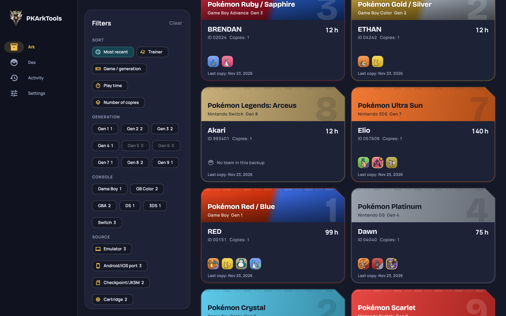
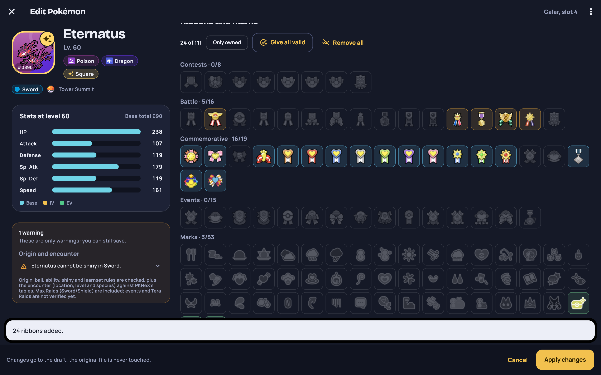
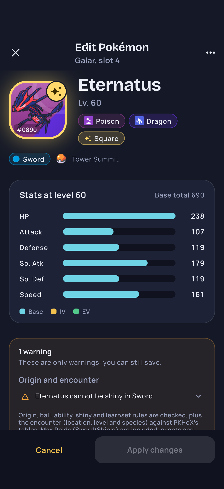
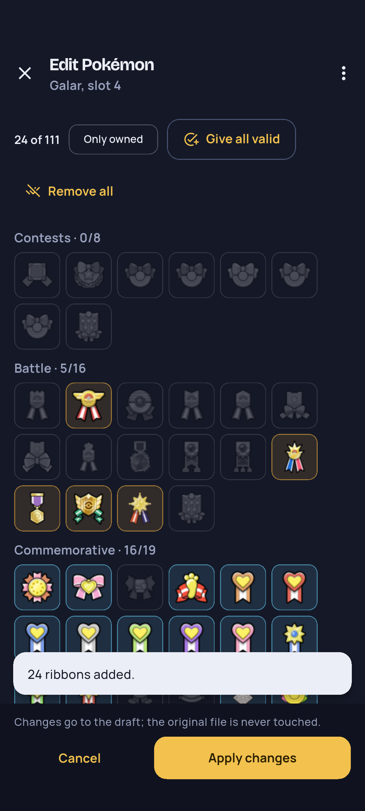

<p align="center">
  
</p>

<h1 align="center">PKArkTools</h1>

<p align="center">
  <b>The Ark for your game saves: versioned backups, a reader and an editor for every generation, on every device.</b>
</p>

<p align="center">
  <a href="docs/media/pkarktools-demo.mp4"></a><br>
  <sub>▶ <a href="docs/media/pkarktools-demo.mp4">Watch the full demo (40 s, MP4)</a> · <a href="#demo">what it shows</a></sub>
</p>

<p align="center">
  <a href="https://github.com/Rodriqe/PKArkTools/actions/workflows/ci.yml"></a>
  <a href="LICENSE"></a>
  
  <a href="https://flutter.dev"></a>
</p>

<p align="center">
  <b>English</b> · <a href="README.es.md">Español</a>
</p>

> [!IMPORTANT]
> **Disclaimer.** PKArkTools is an unofficial, non-commercial **fan project**. It
> is **not affiliated with, endorsed or sponsored by Nintendo, Game Freak,
> Creatures Inc. or The Pokémon Company**. Pokémon and all related names are
> trademarks of their respective owners. The app and this repository include
> **no ROMs, BIOS, console keys or sprites** (icons are optionally downloaded
> on demand, see [Icons](docs/usuario/iconos.md)). Use it **only with your own
> saves**, made from games you own.

<p align="center">
  
</p>

## What is it?

Every save you import goes into **the Ark** (*el Arca*): a folder **you**
choose, where each copy is stored **immutable and versioned**, next to a
readable `.json` with its game, trainer, date and SHA-256. The original file
is never touched. From there you can browse the history of each playthrough,
compare copies, read and edit everything inside a save, and export a verified
file back to your console or emulator.

No accounts, no servers, no telemetry: put the Ark in iCloud Drive, Google
Drive, OneDrive, Dropbox or Syncthing and all your devices share it.

## Features

**Ark and versioned backups**
* Immutable copies named `Game/Trainer (ID)/date_time_hash.sav`, deduplicated
  by SHA-256 and verified on every read.
* History per playthrough with origin (file, folder, editor, demo), notes and
  a "latest" marker; restore or export any copy; activity log.
* **Compare copies**: what changed between two snapshots — trainer, Pokémon
  added, removed, changed (field by field) or moved, inventory and Pokédex.
* Export / restore the whole Ark as a **zip** with a manifest.

**Your own folder, multi-device**
* The Ark lives in a folder you pick (or the app's local folder), with
  persistent access on every platform (security-scoped bookmarks on
  Apple, Storage Access Framework on Android).
* Several devices can write to the same synced folder: unique file names,
  conflict copies and cloud placeholders are detected, the index is rebuilt
  from the folder at any time (*Reindex*), and loose saves you copy in by hand
  are offered for adoption.

**Import from anywhere**
* Single files or whole folders (bulk import with a summary first): GB/GBA/DS
  emulators (raw `.sav`/`.srm`, DeSmuME `.dsv`, RTC footers), Switch emulators
  (Yuzu/Eden/Sudachi/Citron, Ryujinx) and their Android ports, cartridge dumps
  and **Checkpoint / JKSM** backups ([import guide](docs/usuario/importar.md)).
* Detection by content (size, structure, checksums), never by extension;
  ROMs, keys and other files are ignored without being opened.

**Reading — all generations**
* Every main-series game from Red/Blue to Legends: Z-A: trainer, party, boxes,
  play time, money, badges, checksum status.

**Editor**
* Draft with undo/redo; nothing is written until you **Save to the Ark**
  (a new copy) or **export** (re-read and verified before writing).
* **Pokémon**: species and form, nickname, level/EXP, nature (and mint), ability,
  held item, moves and PP, IVs/EVs (AVs, GVs) with presets, shiny (PID/EC
  regenerated), gender, friendship, Ball, OT/TID/SID, language, tera type;
  live stats.
* **Boxes** with drag & drop, **trainer**, **inventory**, **Pokédex** (seen /
  caught / gender / shiny / forms), **events** with names, **ribbons and
  marks**, **origin** (game, location, date, OT).
* Loose Pokémon files `.pk1` … `.pk9`, `.pb7`, `.pb8`, `.pa8`, `.pa9`.

**Legality**
* Warnings ported from PKHeX.Core's rules and encounter tables (moves, stats,
  abilities, Balls, shiny locks, encounter location and level), with
  explanations and "try to fix".

**Damaged saves**
* Checksum diagnosis per block and **repair checksums** on export
  ([guide](docs/usuario/reparar-checksums.md)).

**Look and feel**
* Species, item, Ball and ribbon **icons downloaded on demand** (optional,
  cached, resumable) — the only network access the app makes.
* Cards coloured **per game version** (pairs shown on a diagonal), light and
  dark themes, Spanish and English.

## Supported games

| Games | Platform | Read | Write | Extras |
|---|---|:-:|:-:|---|
| Red / Blue / Yellow (intl. & JP) | Game Boy | ✅ | ✅ | Pokédex, inventory + PC, raw events, `.pk1` |
| Gold / Silver / Crystal (intl., JP, KR) | Game Boy Color | ✅ | ✅ | Pokédex, named events, `.pk2` |
| Ruby / Sapphire, Emerald, FireRed / LeafGreen | GBA | ✅ | ✅ | Pokédex, events, ribbons, wild encounters, `.pk3` |
| Diamond / Pearl, Platinum, HeartGold / SoulSilver | DS | ✅ | ✅ | Pokédex + gender, events, ribbons, full encounter legality, `.pk4` |
| Black / White, Black 2 / White 2 | DS | ✅ | ✅ | Pokédex + gender/shiny, events, ribbons, encounters, `.pk5` |
| X / Y, Omega Ruby / Alpha Sapphire | 3DS | ✅ | ✅ | Pokédex with forms, events, ribbons, encounters, `.pk6` |
| Sun / Moon, Ultra Sun / Ultra Moon | 3DS | ✅ | ✅ + MemeCrypto | Pokédex, events, ribbons, encounters, `.pk7` |
| Let's Go, Pikachu! / Eevee! | Switch | ✅ | ✅ + AVs | Pokédex, events, `.pb7` |
| Sword / Shield | Switch | ✅ | ✅ | Galar + DLC Pokédex, named blocks, ribbons & marks, `.pk8` |
| Brilliant Diamond / Shining Pearl | Switch | ✅ | ✅ | Pokédex with forms, events, ribbons, `.pb8` |
| Legends: Arceus | Switch | ✅ | ✅ + GVs | Hisui Pokédex by form, named blocks, `.pa8` |
| Scarlet / Violet | Switch | ✅ | ✅ + tera type | Paldea, Kitakami, Blueberry Pokédex, `.pk9` |
| Legends: Z-A | Switch | ✅ | ✅ | Lumiose & Hyperspace Pokédex, `.pa9` |

Details, containers and known limits: [docs/formatos.md](docs/formatos.md).

## Demo

[**Watch the demo video**](docs/media/pkarktools-demo.mp4) (40 s, 1080p, no
audio), recorded on an Android emulator with synthetic saves: the welcome
screen, the Ark with a colour for every version, filters, a save with its party
and boxes, the Pokémon editor (level, shiny, moves), origin and ribbons,
legality warnings with safe fixes, and saving a new copy to the Ark to compare
it with the previous one. The animated preview above is the first 12 seconds.

The video is rebuilt from the recordings with `tool/record_demo_video.sh` and
`tool/make_demo_video.sh` (see [Development](docs/desarrollo.md#vídeo-de-demostración)).

## Screenshots

| Desktop | | |
|---|---|---|
|  |  |  |
|  |  |  |
|  |  |  |
|  |  |  |

| iPhone | | | Android | | |
|---|---|---|---|---|---|
|  |  |  |  |  |  |

All screenshots use synthetic saves.

## Install

The current version is **v0.1.0**. Download it from the
[latest release](https://github.com/Rodriqe/PKArkTools/releases/latest)
([all releases](https://github.com/Rodriqe/PKArkTools/releases),
[changelog](CHANGELOG.md)).

| Platform | How |
|---|---|
| Android | `PKArkTools-v0.1.0.apk`: open it on the phone and allow installing from that source when Android asks. |
| macOS | `PKArkTools-v0.1.0-macos.zip`: unzip it and move `PKArkTools.app` to Applications. It is not notarized, so the first time **right-click → Open → Open**. |
| iPhone / iPad | No downloadable build yet: compile it from source with Xcode (below). |
| Windows | `PKArkTools-v0.1.0-windows-x64-setup.exe` (installer) or `PKArkTools-v0.1.0-windows-x64.zip` (portable: unzip and run `PKArkTools.exe`). It is not signed: if SmartScreen warns, click **More info → Run anyway**. |
| Linux | `PKArkTools-v0.1.0-linux-x64.tar.gz`: extract it and run `PKArkTools/pkarktools` (GTK 3; the folder picker needs `zenity` or `kdialog`). |

> The Windows and Linux builds are produced and checked by CI only: nobody has
> tested them on a real PC yet. Reports are welcome in
> [Issues](https://github.com/Rodriqe/PKArkTools/issues).

## Build from source

Requires Flutter stable (3.47+). Then:

```bash
git clone https://github.com/Rodriqe/PKArkTools.git
cd PKArkTools
flutter pub get
tool/ci.sh                          # analysis, tests, doc links
cd apps/pkarktools
flutter run                         # or: flutter build apk | macos | ios | windows | linux
```

The repo is a Dart workspace: `packages/pkcore` (pure Dart core: detection,
reading, writing, legality) and `apps/pkarktools` (Flutter app). See
[Architecture](docs/arquitectura.md) and [Development](docs/desarrollo.md).

## Your data

Saves never leave your device or your folder; the original file is never
modified; every copy and export is verified by SHA-256 / re-reading; nothing
is ever overwritten. The only network request is the optional icon download.
Read [Data safety and privacy](docs/seguridad-datos.md).

## Documentation

Full documentation (in Spanish) lives in [`docs/`](docs/README.md):
[user guide](docs/usuario/README.md) ·
[supported formats](docs/formatos.md) ·
[data safety](docs/seguridad-datos.md) ·
[architecture](docs/arquitectura.md) ·
[development](docs/desarrollo.md) ·
[store publishing](docs/publicacion.md) ·
[licenses](docs/licencias.md) ·
[changelog](CHANGELOG.md).

## Contributing

Issues and pull requests are welcome. Please read
[CONTRIBUTING.md](CONTRIBUTING.md), the [Code of Conduct](CODE_OF_CONDUCT.md)
and, for vulnerabilities, [SECURITY.md](SECURITY.md). Never attach ROMs, keys
or other people's saves.

## Credits

* [**PKHeX**](https://github.com/kwsch/PKHeX) by Kaphotics and contributors
  (GPL-3.0): save formats, encryption, checksums, legality rules and game data
  are ported from PKHeX.Core; the optional icons are downloaded from the
  PKHeX repository.
* [**PokeAPI**](https://github.com/PokeAPI/pokeapi) (BSD-3-Clause): species
  names, types, experience tables and evolution chains.
* Fonts **Manrope** and **Bricolage Grotesque** (SIL OFL 1.1).
* Full list in [`NOTICE`](NOTICE) and [docs/licencias.md](docs/licencias.md).

## License

[GPL-3.0](LICENSE). Pokémon © Nintendo, Creatures Inc., GAME FREAK inc.;
this project is not affiliated with them.
