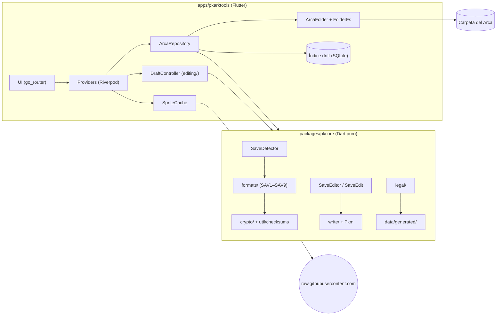
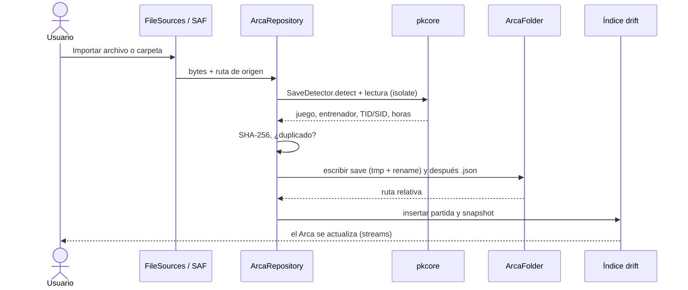
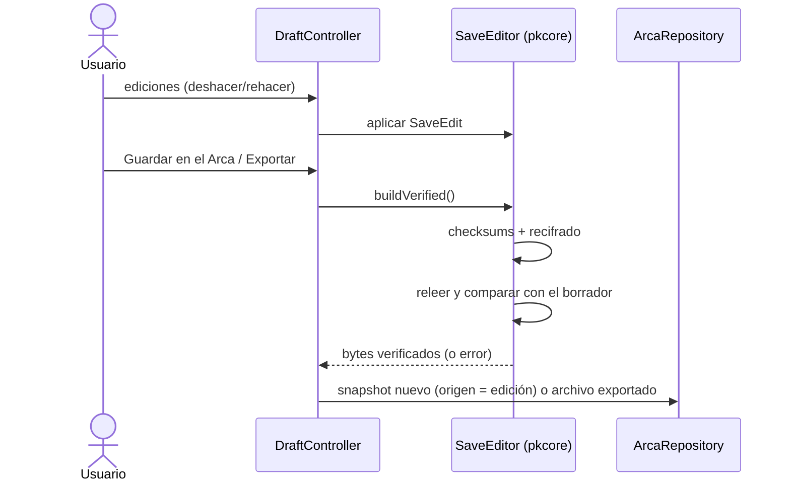
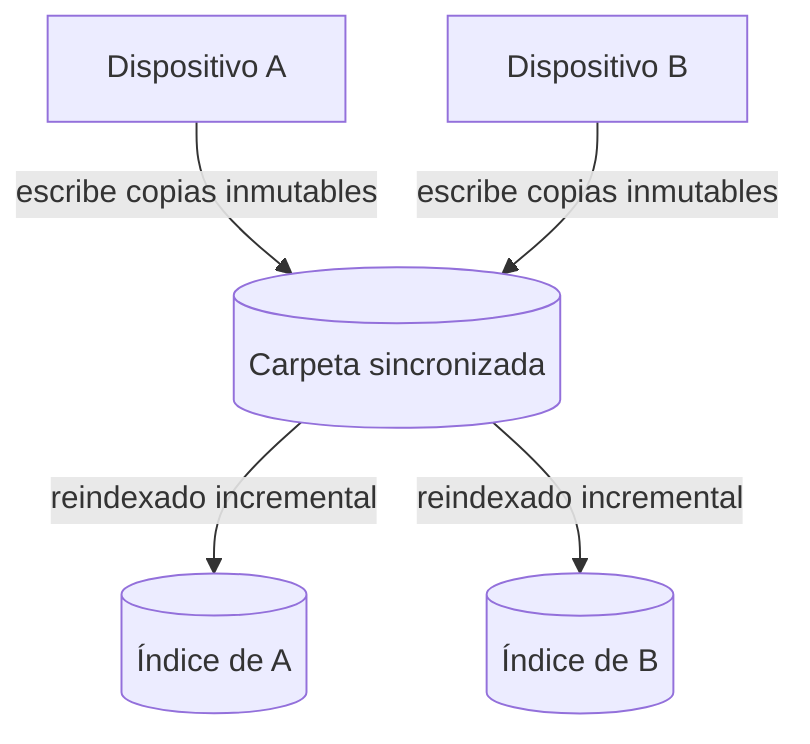

# Arquitectura

## Monorepo

Un *workspace* de Dart (`pubspec.yaml` raíz con `workspace:`) con dos
paquetes y herramientas:

```
packages/pkcore         Dart puro: detección, lectura, cifrados, checksums,
                        escritura, legalidad y datos generados (sin Flutter)
apps/pkarktools        App Flutter: Arca, importación, editor, UI
tool/                   Generadores de tablas (PKHeX, PokeAPI), CI local,
                        entorno Android, verificación de enlaces
tools/pkhex_oracle      Oráculo .NET que enlaza PKHeX.Core para comparar
docs/                   Esta documentación y las capturas
```

`flutter pub get` en la raíz resuelve todo el workspace; `pkcore` se puede
probar con `dart test` sin Flutter.



## `pkcore`

| Módulo | Responsabilidad |
|---|---|
| `detect/save_detector.dart` | `SaveDetector.detect(bytes)`: quita contenedores (DeSmuME, pie RTC), identifica el juego por tamaño, estructura y checksums y devuelve una `Detection` perezosa. Los errores explican la causa (`UnsupportedSaveException`). |
| `formats/` | Lectores por familia: `gb_saves` (Gen 1–2, regiones JP/KOR), `gen3`, `nds_saves` (Gen 4–5), `ctr_saves` (3DS), `switch_saves` (Let's Go, SwSh, DBPR, LA, SV, Z-A). Producen el modelo `SaveFile` (`model/save.dart`). |
| `crypto/` | `PkCrypto` (cifrado/barajado PK3–PK9), `SwishCrypto` + `SCBlock`/`SCXorShift32` (Switch), `MemeCrypto` (firma SM/USUM). |
| `util/checksums.dart` | Checksums Gen 1–3, CRC16-CCITT, CRC BEEF, MD5/SHA-256. |
| `pkm/` | `Pkm`: lectura y escritura de PK1…PK9, PB7, PB8, PA8, PA9 (campos, estadísticas, PID/EC variocolor). |
| `edit/` | `SaveEditor.open(bytes)` elige el editor de la familia (GB, GBA, NDS, 3DS, Let's Go, BDSP, Switch). `SaveEdit` es una lista de ediciones serializables; `buildVerified()` recalcula checksums, recifra, relee y compara. `SaveVerifier` diagnostica daños (`SaveDamage.minor/major`). También Pokédex, eventos, `save_diff` (comparación) e inferencia de versión. |
| `write/save_writer.dart` | `EditorSaveWriter`: aplica ediciones y reconstruye el contenedor. |
| `legal/` | Legalidad: básica, orígenes, Balls por juego, encuentros (tablas de PKHeX), origen del Pokémon y cintas. Devuelve avisos con área, explicación y corrección segura opcional. |
| `data/generated/` | Tablas generadas por `tool/gen_*.py` desde PKHeX.Core y PokeAPI (especies, movimientos, objetos, learnsets, Pokédex, eventos, encuentros, cintas, charsets). **No se editan a mano.** |
| `testing/synthetic.dart` | Generador de saves sintéticos válidos para tests, capturas y «partidas de ejemplo». |

Principio: `pkcore` nunca hace E/S. Recibe y devuelve `Uint8List`, así que es
determinista y se prueba con bytes.

## App

* **Estado**: Riverpod 3 (`lib/providers.dart`, `lib/data/arca_session.dart`).
  `arcaSetupProvider` decide entre onboarding, Arca lista o acceso perdido;
  `arcaRepositoryProvider` expone el repositorio; los `StreamProvider` del Arca,
  snapshots y actividad salen de consultas drift; `parsedSnapshotProvider`
  parsea en un *isolate*.
* **Navegación**: go_router (`lib/app.dart`): `/bienvenida`, `/acceso`,
  `/arca`, `/arca/save/:id`, `/actividad`, `/ajustes`, dentro de un
  `StatefulShellRoute` con barra lateral (escritorio) o inferior (teléfono).
* **Edición**: `lib/editing/draft.dart` (`DraftController`): pila de
  `SaveEdit` sobre los bytes del snapshot; deshacer reconstruye desde los
  bytes originales. Exportar y guardar llaman a `buildVerified`.
* **Localización**: `flutter gen-l10n` con `lib/l10n/app_es.arb` (plantilla) y
  `app_en.arb`; `tool/l10n_add.py` añade claves a ambos.
* **Tema**: `lib/theme/` (oscuro/claro), fuentes Manrope y Bricolage
  Grotesque empaquetadas.

### La carpeta del Arca

La carpeta es la **fuente de verdad**; drift es solo un **índice local** por
dispositivo (en el directorio de soporte de la app) que se puede borrar y
reconstruir.

| Clase (`lib/data/folder/`) | Papel |
|---|---|
| `ArcaLayout` | Nombres y rutas: `<Juego>/<Entrenador (TID)>/historial/<fecha>_<hora>_<sha8>.<ext>` + `.json`; nombre del archivo principal por juego (`mainFileName`); patrones de copias gestionadas, conflictos de nube e ignorados. |
| `ArcaFolder` | Escribe copias (temporal + rename, `.json` después), lista, verifica SHA-256, detecta problemas, saves sueltos, `ultima.json` y conflictos. |
| `ArcaMainFiles` | Mantiene el archivo principal de cada carpeta de entrenador como copia derivada de la entrada más reciente del historial: lo escribe con `writeReplace` (atómico), detecta el reemplazado a mano (SHA-256 fuera del historial), espera si otro dispositivo va por delante (`ultima.json` más nuevo) y retira copias de conflicto con contenido conocido. |
| `ArcaGameFolders` | Carpetas por juego opcionales con `LEEME.txt`; también identifican la bandeja de entrada. |
| `FolderFs` | Abstracción de sistema de archivos: `IoFolderFs` (`dart:io`), `SafFolderFs` (Android, por *method channel*; `treeReplace` en `MainActivity.kt` para los derivados) y `MemoryFolderFs` (tests y capturas). `writeNew` nunca sobrescribe (historial); `writeReplace` reemplaza de forma atómica (principal, `ultima.json`, README). |
| `FolderAccess` | Elegir/abrir la carpeta y conservar el permiso: bookmarks con *security scope* (iOS/macOS, en `AppDelegate.swift` / `MainFlutterWindow.swift`), SAF con `takePersistableUriPermission` (Android, `MainActivity.kt`), ruta directa (Windows/Linux). |
| `ArcaMigration` | Migra el Arca interna antigua, pasa las copias sueltas de 0.1.0 a `historial/` (idempotente, verificando cada una antes de retirar la original) y mueve/copia entre carpetas con verificación. |

`ArcaRepository` (`lib/data/arca_repository.dart`) une todo: importar,
reindexar (incremental, con *watcher* en escritorio y al volver a primer
plano), migrar al diseño con `historial/`, recalcular los archivos
principales, recoger la bandeja de entrada, adoptar, guardar ediciones,
restaurar como versión actual, fijar versión, eliminar y exportar/restaurar el
zip (`arca_archive.dart`).

Orden de un reindexado: listar → (migrar a `historial/` si hace falta, sin
cambiar los ids del índice) → indexar copias nuevas y quitar las que faltan →
`ArcaMainFiles.sync` → bandeja de entrada (lo recogido provoca otra pasada).
El índice local (drift, esquema 4) ya no exige `(partida, sha256)` único: una
restauración es una entrada propia aunque repita contenido; la deduplicación
de importaciones la hace el repositorio.

### Acceso a archivos por plataforma

| Plataforma | Selector | Persistencia | Lectura/escritura |
|---|---|---|---|
| Android | `ACTION_OPEN_DOCUMENT_TREE` (SAF) y `file_picker` | `takePersistableUriPermission` | `DocumentsContract` vía canal `dev.pkarktools/saf` |
| iOS | `UIDocumentPickerViewController` (carpetas) y `file_picker` | Bookmark | `dart:io` dentro de `startAccessingSecurityScopedResource` |
| macOS | `NSOpenPanel` | Bookmark con *security scope* (`files.bookmarks.app-scope`) | `dart:io` |
| Windows / Linux | Selector del sistema | Ruta | `dart:io` |

### Caché de iconos

`lib/data/sprites/sprite_cache.dart`: memoria (LRU, 400 entradas) → disco
(`getApplicationCacheDirectory()/sprites/<commits>`; las carpetas de commits
anteriores se borran) → red (un único
`HttpClient` con conexiones persistentes; raw.githubusercontent.com y, solo
ante errores transitorios, jsDelivr; timeouts de 8/15 s, 2 reintentos con
backoff solo ante error de red o HTTP 429/5xx, fallos recordados 2 minutos).
«Descargar todos» usa 32 descargas simultáneas, empieza por los equipos de los
saves del Arca, es cancelable y reanudable (salta lo que ya está en disco) y,
si ningún servidor responde (sin red o sin permiso de Internet), se corta en
~2 s en vez de reintentar archivo por archivo. Límites de
512 KB por archivo y 64 MB en total. `sprite_manifest.g.dart` (generado por
`tool/gen_sprite_manifest.py`) lista los iconos que existen en cada commit
fijado, con su tamaño exacto (se verifica cada descarga), así que nunca se
piden rutas inexistentes.

Fuentes (por grupo, en `kSpriteSources`/`kSpriteCommits`):

| Grupo | Repositorio | Carpeta |
| --- | --- | --- |
| `pokemon` | `smogon/sprites` | `src/minisprites/pokemon/home` (iconos de HOME, 1025 especies + formas + huevo) |
| `item`, `ball`, `ribbon`, `type` | `kwsch/PKHeX` | `PKHeX.Drawing.*/Resources/img/…` |

Especie y forma → archivo: `kPokemonIconBase` (nombre «aplanado» de smogon por
especie, de los nombres en inglés de PKHeX) y `kPokemonIconForms`
(«especie-forma» con los índices de forma de PKHeX). Esta tabla se genera a
partir de los volcados de HOME del mismo repositorio
(`src/_uncategorized/canonical/home/small*`, que llevan número de especie y de
forma) más la tabla explícita `HAND_FORMS` del generador (Gen 9, Hisui y lo
que el volcado no recoge). Una forma sin icono propio (megas nuevas de
Leyendas Z-A, Teraforma de Terapagos, tipos de Silvally…) usa el de la
especie. No hay iconos variocolor: el avatar pone la insignia.

Escala (`SpriteLayout` en `lib/ui/common/sprite_image.dart`): el generador mide
el contenido no transparente de cada PNG y guarda por grupo el percentil 92
del lado que necesita (`kSpriteContentRef`) y los que lo superan
(`kSpriteOversize`). Todos los iconos de un grupo usan la misma escala, la que
hace que ese lado de referencia llene el 88 % del hueco (Pokémon y objetos;
tipos, cintas y Balls, el 100 %); uno que no cabría se reduce lo justo. El arte
de píxeles (objetos, Balls) usa la mayor escala entera si aprovecha ≥ 80 % de
la exacta y, si no, la exacta, siempre con vecino más próximo al ampliar; los
iconos de HOME, tipos y cintas se suavizan.

## Flujo de datos

### Importar



### Editar y exportar



### Varios dispositivos



Sin servidor ni bloqueo: como ninguna copia se sobrescribe, no hay
conflictos de escritura; las «copias en conflicto» que creen los servicios de
nube se ignoran.

## Tests

* `packages/pkcore/test/`: ida y vuelta y edición de cada formato, mutación
  (robustez), cifrados, Pokédex, eventos, legalidad (incluido un test contra
  salidas del oráculo PKHeX) y pruebas opcionales con saves reales.
* `apps/pkarktools/test/`: carpeta del Arca (layout, reindexado, dos
  dispositivos, conflictos, migración), UI de carpeta, editor, fases 3–4,
  diseño de teléfono sin desbordes y capturas de escritorio offscreen.
* `apps/pkarktools/integration_test/`: arneses de capturas en emulador o
  simulador y prueba opcional con saves reales.

Ver [Desarrollo](desarrollo.md).
