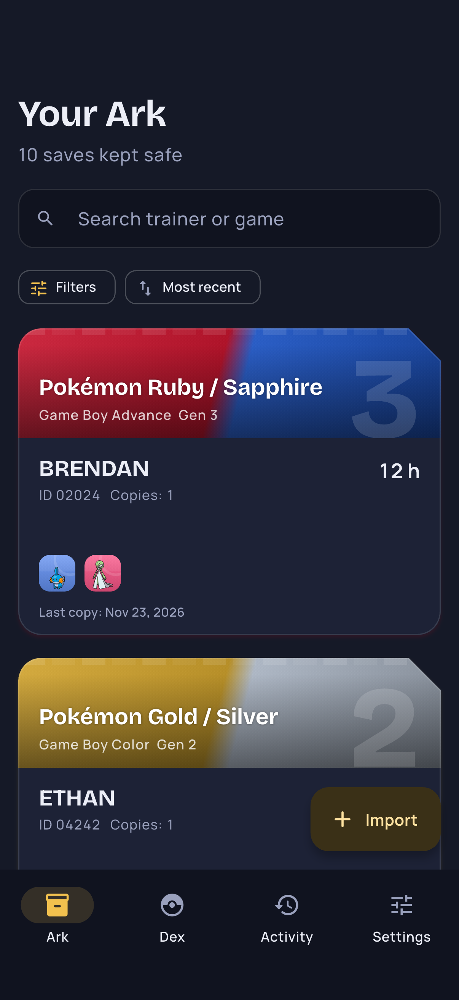
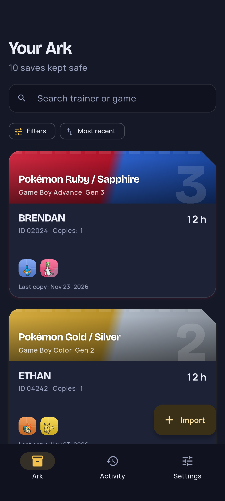
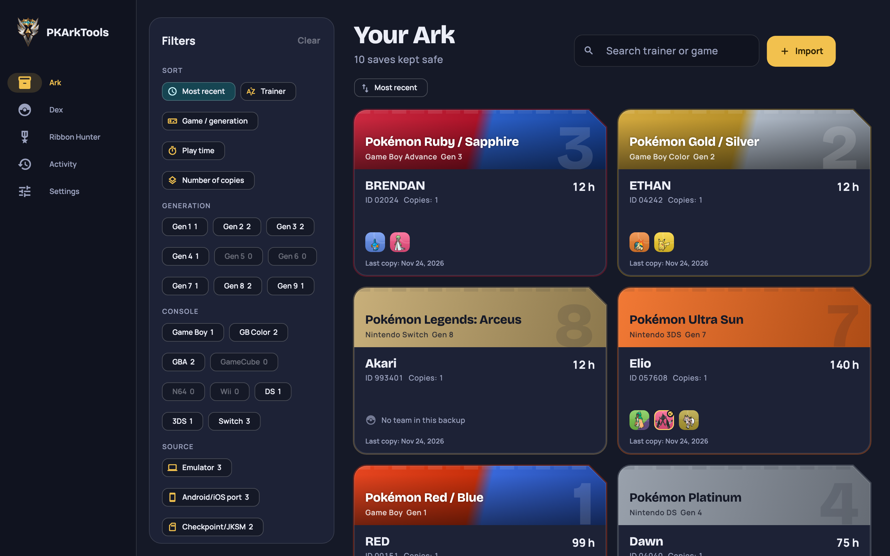

# Guía de usuario

PKArkTools guarda tus partidas de Pokémon en un **Arca**: una carpeta que tú
eliges donde cada copia es un archivo que nunca se sobrescribe. Desde el Arca
puedes ver lo que hay en cada partida, compararla con copias anteriores,
editarla y exportarla lista para el juego o el emulador.

1. [Primeros pasos](primeros-pasos.md): elegir la carpeta del Arca, usarla en varios dispositivos y probar con partidas de ejemplo.
2. [Importar saves](importar.md): un archivo, una carpeta entera, emuladores y exports de Checkpoint/JKSM.
3. [El Arca](arca.md): historial, notas, versión del cartucho, comparar, exportar, restaurar y zip.
4. [Editor](editor.md): Pokémon, cajas, entrenador, inventario, Pokédex, eventos, cintas y origen.
5. [Dex](dex.md): la Pokédex global de todas tus partidas, formas especiales desbloqueables y living dex.
6. [Ribbon Hunter](ribbon-hunter.md): todas las cintas que puede ganar un ejemplar de cada especie, juego a juego, y el ranking por niveles.
7. [Legalidad y avisos](legalidad.md): qué se comprueba y qué hace «Intentar corregir».
8. [Saves dañados y reparar checksums](reparar-checksums.md).
9. [Iconos](iconos.md): sprites bajo demanda y su caché.
10. [Preguntas frecuentes y solución de problemas](faq.md).
11. [Herramientas](herramientas.md): importar y exportar texto de Showdown, calculadora de stats e IVs, ordenar cajas y tarjeta para compartir.
12. [Formato oficial](formato-oficial.md): la regulación vigente de Pokémon Champions y qué Pokémon de tus partidas valen.
13. [Emuladores](emuladores.md): vincular y respaldar carpetas de saves, abrir el emulador y compatibilidad.
14. [Instalar](instalar.md): todas las plataformas, y iPhone/iPad con AltStore.

Consulta también [Formatos soportados](../formatos.md) y
[Seguridad de datos y privacidad](../seguridad-datos.md).

## Plataformas

| | Android | iOS / iPadOS | macOS | Windows | Linux |
|---|---|---|---|---|---|
| Carpeta del Arca | Selector del sistema (SAF) | Archivos (iCloud Drive, En mi iPhone…) | Selector (iCloud Drive por defecto) | Selector | Selector |
| Importar carpeta de emulador | Sí, por SAF | Sí, si el emulador la expone en Archivos | Sí | Sí | Sí |
| Atajos de teclado | — | Teclado externo | ⌘Z / ⇧⌘Z | Ctrl+Z / Ctrl+Shift+Z | Ctrl+Z / Ctrl+Shift+Z |

En teléfono (ancho menor de 600 puntos) las secciones del detalle se muestran
como píldoras desplazables, los diálogos como hojas inferiores y el editor a
pantalla completa.

  
  
  

