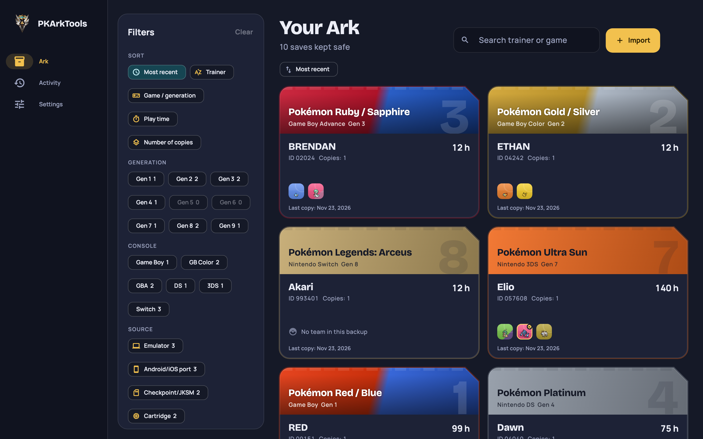
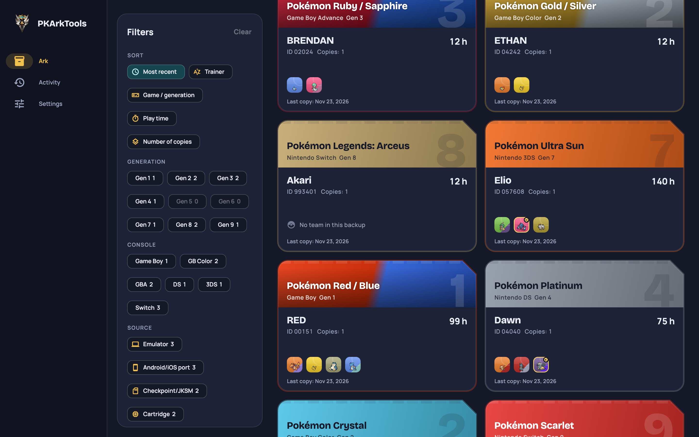
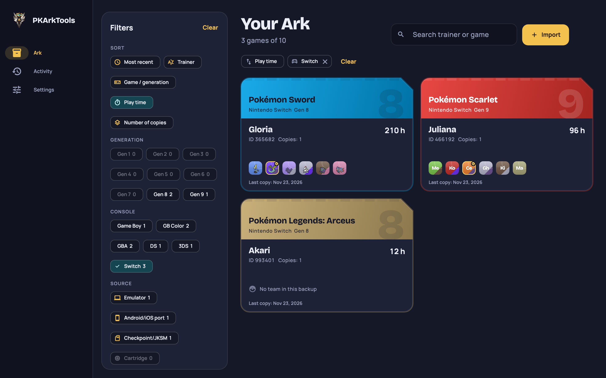
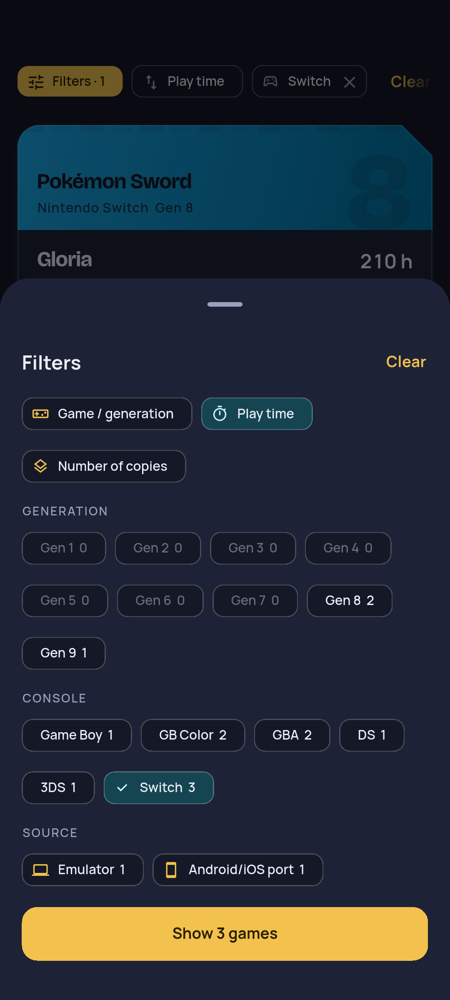
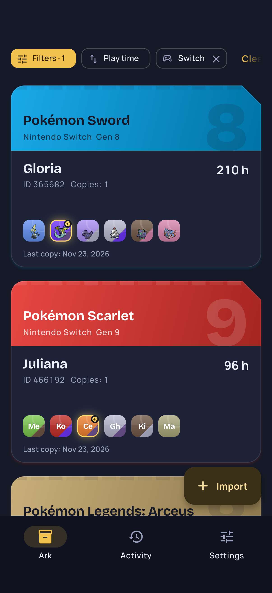
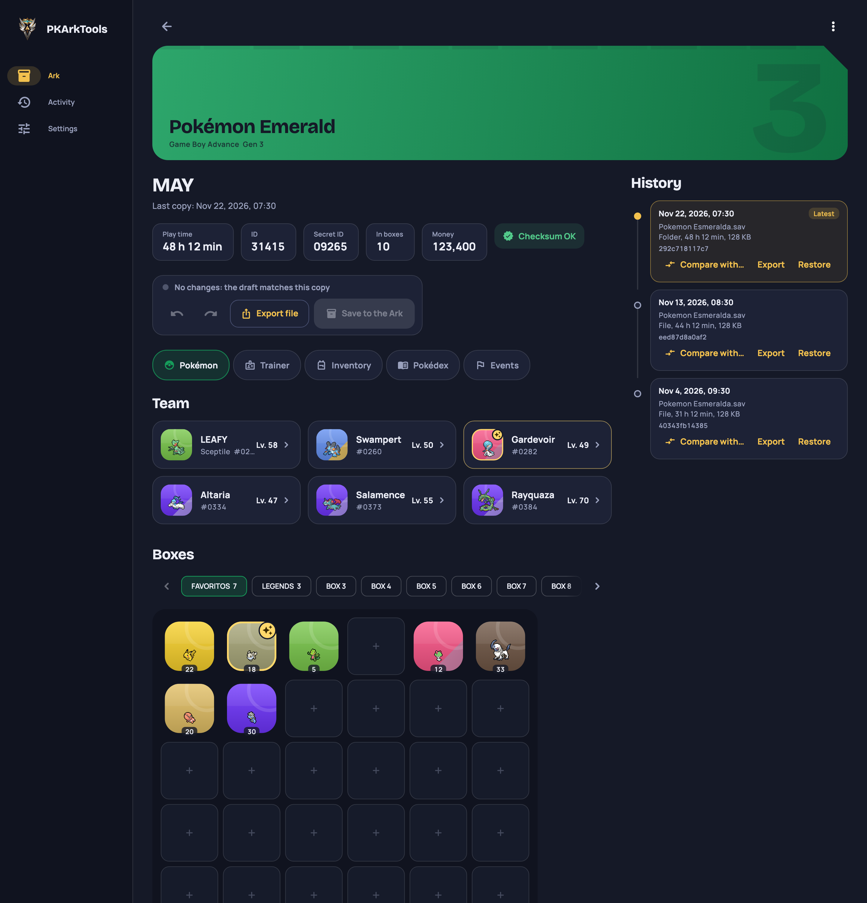
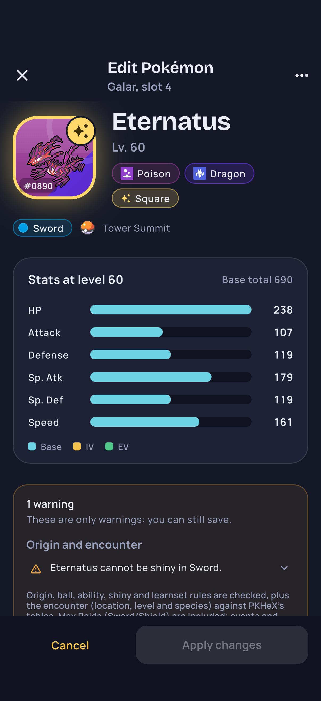

# El Arca

El Arca muestra una tarjeta por partida (juego + entrenador). El color de la
tarjeta es el de la versión del cartucho cuando se conoce; si no, la pareja
del juego en diagonal (Rojo/Azul, Oro/Plata, Rubí/Zafiro…).

  
  

La versión se deduce del save o del juego de origen de los Pokémon del propio
entrenador. Si no se puede deducir, fíjala con **Fijar versión del juego…**
en el detalle; se guarda en el `.json` de la copia.

## Buscar, filtrar y ordenar

El buscador encuentra partidas por entrenador o juego. Con **Filtros** (en el
teléfono, el primer chip de la fila bajo el buscador, que abre una hoja con
todo; en escritorio ancho, el panel de la izquierda) puedes combinar:

* **Generación** (1–9) y **consola** (Game Boy, GB Color, GBA, DS, 3DS,
  Switch).
* **Origen** de las copias: emulador de escritorio, port de Android/iOS,
  Checkpoint/JKSM o cartucho. Se deduce de la ruta y del contenedor del save
  (por ejemplo, `Checkpoint/saves/…`, `nand/user/save/…`, `.dsv` de DeSmuME o
  la carpeta de un lector de cartuchos); lo que no se puede saber queda como
  «Otro / desconocido».
* **Juego** concreto, con el color de su versión (Espada y Escudo por
  separado).
* **Estado**: con avisos de daño (checksums o lectura), con avisos de
  legalidad (se revisan todos los Pokémon de la última copia al elegirlo, con
  una barra de progreso), editadas por ti en la app o con varias copias.
* **Última copia**: última semana, último mes, último año o un rango de
  fechas.

Dentro de un grupo las opciones se suman (Gen 3 **o** Gen 4); entre grupos se
combinan (Gen 3 **y** emulador). Cada opción muestra cuántas partidas quedarían
y se desactiva si no queda ninguna. Los filtros activos aparecen como chips
que se quitan con su ✕, junto a **Limpiar**, y el título indica «N partidas de
M». El orden puede ser por más reciente, entrenador, juego/generación, horas
de juego o número de copias.

  
  
  

La selección se recuerda **en este dispositivo** (en el índice local, nunca en
la carpeta del Arca); la búsqueda no.

## Detalle de una partida

Pestañas: resumen, equipo, cajas, entrenador, inventario, Pokédex, eventos e
historial. Toca un Pokémon para ver su ficha (estadísticas, movimientos,
origen, cintas).

  
  

## Historial

Cada importación, edición guardada o restauración crea una **copia nueva e
inmutable** con fecha, origen (importación, edición, restauración) y una nota
opcional. Desde el historial puedes, para cada copia:

* **Exportar archivo**: escribe un archivo listo para el juego o el emulador
  conservando su contenedor. Antes de entregarlo se relee y se compara
  (checksums, entrenador, equipo, cajas, inventario, Pokédex y eventos).
* **Restaurar**: ver más abajo.
* **Comparar con…**: ver más abajo.

Las ediciones se hacen directamente en las pestañas del detalle (equipo, cajas,
entrenador…) sobre un borrador; ver [Editor](editor.md).

La pestaña **Actividad** lista todo lo que ha pasado en el Arca.

## Comparar copias

**Comparar con…** muestra qué cambió entre dos copias de la misma partida:
entrenador, Pokémon que entraron, salieron, cambiaron (cada campo antes →
después) o se movieron de hueco, inventario y Pokédex.

## Restaurar

**Restaurar** escribe la copia elegida en la **ubicación original** del save
(la carpeta de la que se importó, si la app conserva el permiso). Antes de
escribir, el archivo que hay en ese sitio **se guarda primero en el Arca**, así
que restaurar nunca pierde datos.

## Exportar y restaurar el Arca completa (zip)

En **Ajustes**:

* **Exportar el Arca** crea un zip con
  `PKArkTools-Arca/<juego>/<entrenador>-<id>/<fecha>_<sha>_<archivo>` y un
  `manifest.json` (partidas, SHA-256, fechas, origen, notas y rutas).
* **Restaurar desde zip** recupera las copias con sus fechas y notas,
  comprueba cada SHA-256 y salta las que ya existen.

## Eliminar una partida del Arca

En el menú del detalle, **Eliminar del Arca** borra (tras confirmar) todas las
copias de esa partida **de la carpeta del Arca**, también en los demás
dispositivos que la sincronicen. Los archivos originales de la consola o el
emulador no se tocan. Si quieres conservarlas, exporta antes el zip del Arca.

## Saves sueltos en la carpeta

Si copias un save a mano en cualquier subcarpeta del Arca, Ajustes lo ofrece
para **Adoptar**: se detecta el juego, se coloca en su sitio con su `.json`, se
verifica y solo entonces se retira el suelto. **Adoptar todos** hace lo mismo
con todos.

Un `.json` sin save, un save sin `.json`, un `.json` dañado o un tamaño que no
cuadra se marcan como problema en Ajustes; el resto del Arca sigue
funcionando. El SHA-256 se comprueba cada vez que se lee una copia.

Siguiente: [Editor](editor.md).
