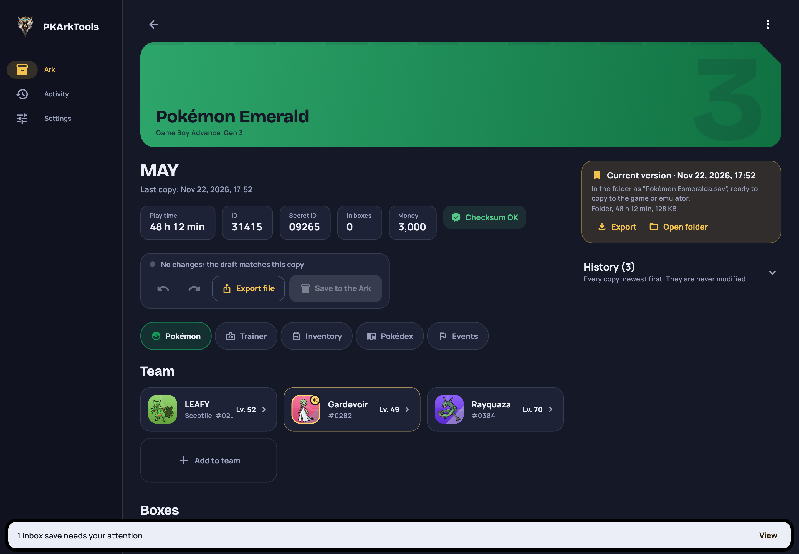
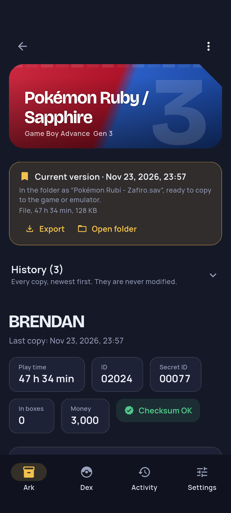
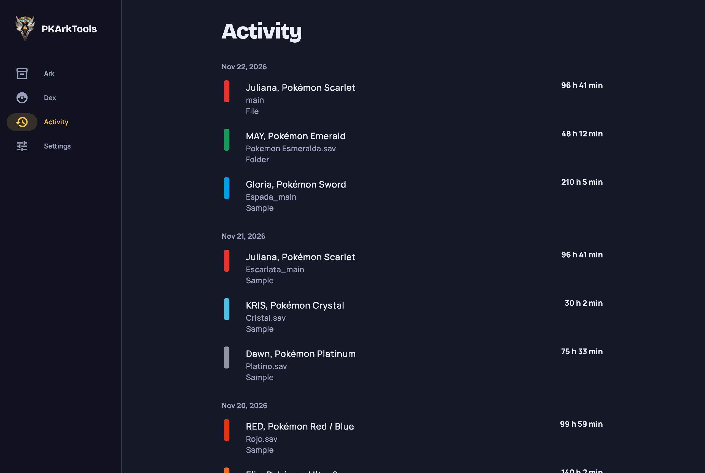
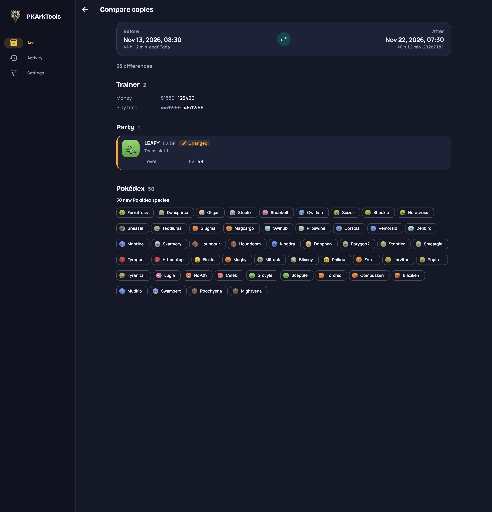
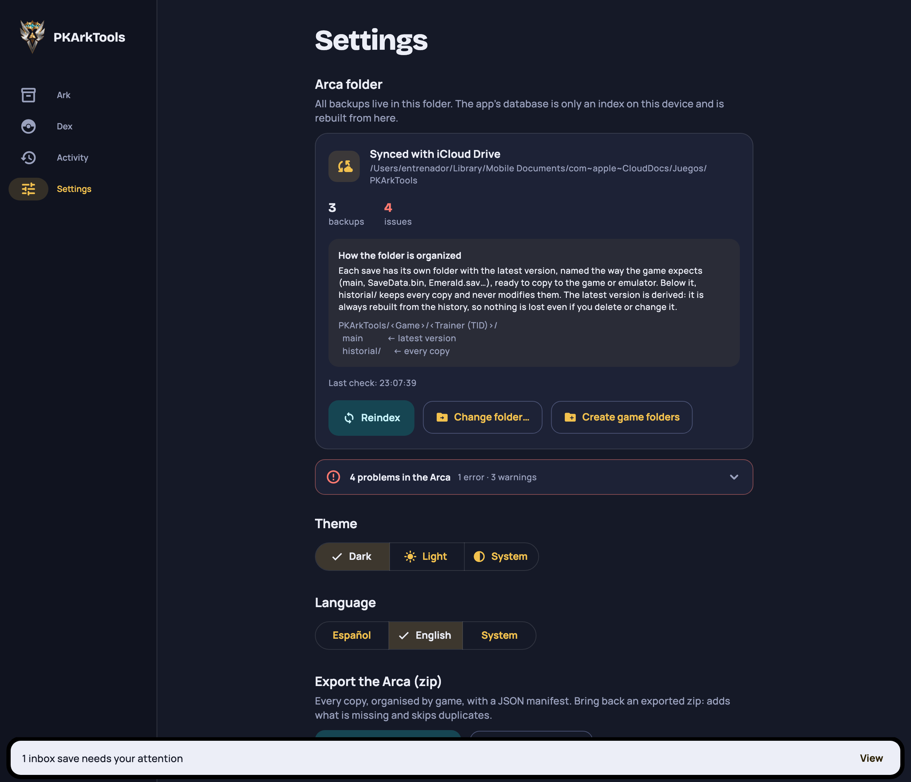
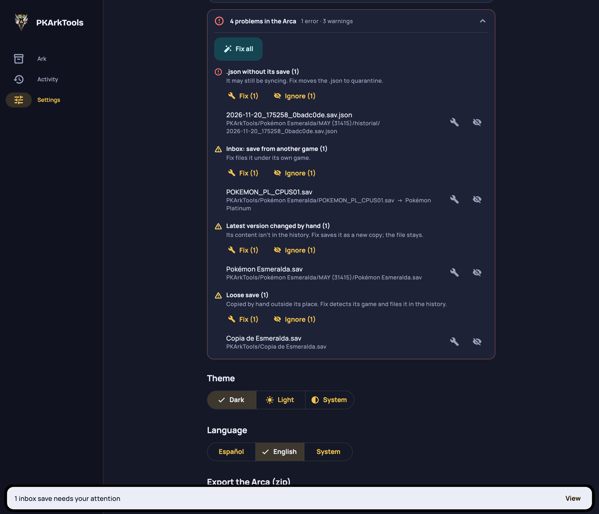
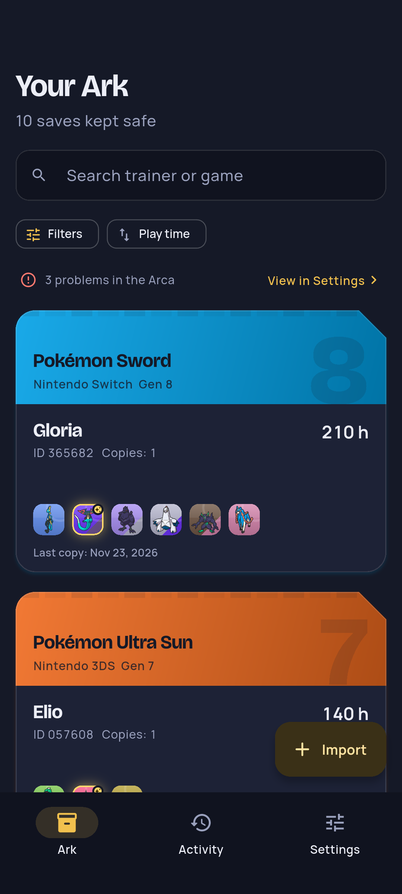
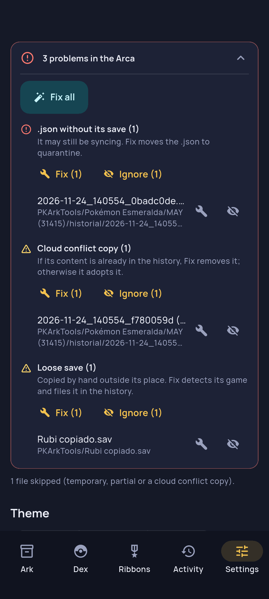
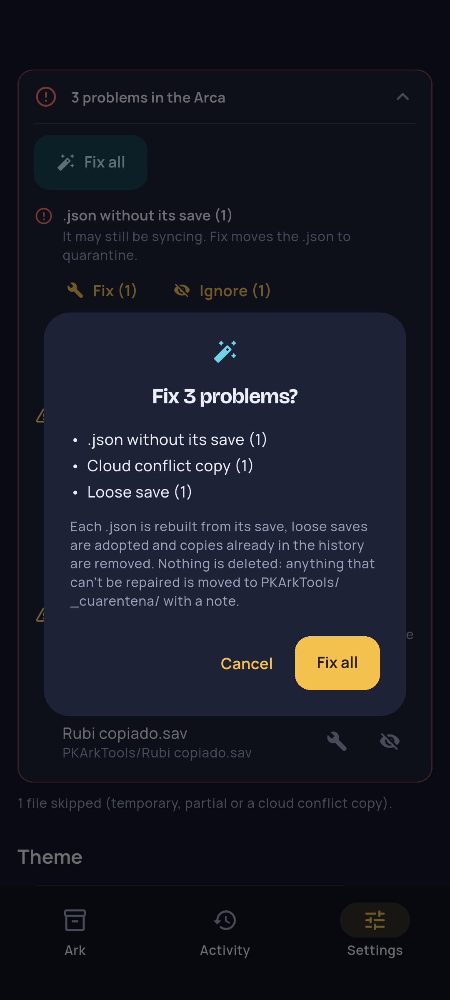

# El Arca

El Arca muestra una tarjeta por partida (juego + entrenador). El color de la
tarjeta es el de la versión del cartucho cuando se conoce; si no, la pareja
del juego en diagonal (Rojo/Azul, Oro/Plata, Rubí/Zafiro…).

<p>
  
  
</p>

La versión se deduce del save o del juego de origen de los Pokémon del propio
entrenador. Si no se puede deducir, fíjala con **Fijar versión del juego…**
en el detalle; se guarda en el `.json` de la copia.

## Buscar, filtrar y ordenar

El buscador encuentra partidas por entrenador o juego. Con **Filtros** (en el
teléfono, el primer chip de la fila bajo el buscador, que abre una hoja con
todo; en escritorio ancho, el panel de la izquierda) puedes combinar:

* **Generación** (1–9) y **consola** (Game Boy, GB Color, GBA, DS, 3DS,
  Switch).
* **Origen** de las copias: emulador de escritorio, port de Android/iOS,
  Checkpoint/JKSM o cartucho. Se deduce de la ruta y del contenedor del save
  (por ejemplo, `Checkpoint/saves/…`, `nand/user/save/…`, `.dsv` de DeSmuME o
  la carpeta de un lector de cartuchos); lo que no se puede saber queda como
  «Otro / desconocido».
* **Juego** concreto, con el color de su versión (Espada y Escudo por
  separado).
* **Estado**: con avisos de daño (checksums o lectura), con avisos de
  legalidad (se revisan todos los Pokémon de la última copia al elegirlo, con
  una barra de progreso), editadas por ti en la app o con varias copias.
* **Última copia**: última semana, último mes, último año o un rango de
  fechas.

Dentro de un grupo las opciones se suman (Gen 3 **o** Gen 4); entre grupos se
combinan (Gen 3 **y** emulador). Cada opción muestra cuántas partidas quedarían
y se desactiva si no queda ninguna. Los filtros activos aparecen como chips
que se quitan con su ✕, junto a **Limpiar**, y el título indica «N partidas de
M». El orden puede ser por más reciente, entrenador, juego/generación, horas
de juego o número de copias.

<p>
  
  
  
</p>

La selección se recuerda **en este dispositivo** (en el índice local, nunca en
la carpeta del Arca); la búsqueda no.

## Detalle de una partida

Pestañas: resumen, equipo, cajas, entrenador, inventario, Pokédex, eventos e
historial. Toca un Pokémon para ver su ficha (estadísticas, movimientos,
origen, cintas).

<p>
  
  
</p>

## Versión actual e historial

En la ficha de la partida, arriba (en el teléfono, antes del equipo; en
escritorio, en la columna derecha) está la **versión actual**: «Versión actual
· <fecha>», con el nombre del archivo que la contiene en la carpeta y dos
botones:

* **Exportar** escribe ese archivo con el nombre que espera el juego (`main`,
  `Pokémon Esmeralda.sav`…). Antes de entregarlo se relee y se compara
  (checksums, entrenador, equipo, cajas, inventario, Pokédex y eventos).
* **Abrir carpeta** abre la carpeta de la partida en el explorador (escritorio)
  o muestra su ruta dentro del Arca para copiarla (Android, iPhone).

<p>
  
  
</p>

Debajo, **plegado**, el **Historial (N)**: cada importación, edición guardada
o restauración es una **copia nueva e inmutable** con fecha, origen
(importación, edición, bandeja de entrada, restaurada…) y una nota opcional.
Para cada copia:

* **Exportar**: el archivo de esa copia, con su fecha en el nombre.
* **Restaurar**: ver más abajo.
* **Comparar con…**: ver más abajo.


Las ediciones se hacen directamente en las pestañas del detalle (equipo, cajas,
entrenador…) sobre un borrador; ver [Editor](editor.md).



La pestaña **Actividad** lista todo lo que ha pasado en el Arca.

## Comparar copias

**Comparar con…** muestra qué cambió entre dos copias de la misma partida:
entrenador, Pokémon que entraron, salieron, cambiaron (cada campo antes →
después) o se movieron de hueco, inventario y Pokédex.



## Restaurar

**Restaurar** convierte una copia antigua en la versión actual: crea una
**entrada nueva** en el historial con su contenido (origen «Restaurada» y una
nota con la fecha de la copia original) y actualiza el archivo de la última
versión. El historial nunca se reescribe: puedes volver a cualquier punto.

Si la copia se importó de un sitio al que la app aún tiene acceso, el diálogo
ofrece además **Restaurar y escribir en el original**: antes de escribir ahí,
lo que haya en ese sitio **se guarda primero en el Arca**, así que nunca se
pierde nada.

## La carpeta por dentro

```
PKArkTools/<Juego>/<Entrenador (TID)>/
  main                      ← ÚLTIMA versión, con el nombre que usa el juego
  ultima.json               ← qué copia del historial es la última (derivado)
  historial/
    2026-11-22_175258_a1fa22cf.sav   (+ .json)   ← todas las copias, inmutables
PKArkTools/_cuarentena/     ← lo que «Arreglar» no pudo reparar, con una nota (nunca se borra)
```

* **El historial es la fuente de verdad.** El archivo de la última versión es
  una copia derivada: se escribe de forma atómica (temporal + renombrar) cada
  vez que entra una copia más nueva, y si falta o se queda atrás se regenera
  desde el historial al reindexar.
* **Nombre por juego.** Es el nombre con el que Checkpoint/JKSM y los
  emuladores esperan el save:

  | Juego | Archivo de la última versión |
  |---|---|
  | Espada/Escudo, Leyendas Arceus, Escarlata/Púrpura, Leyendas Z-A | `main` |
  | Diamante Brillante / Perla Reluciente | `SaveData.bin` |
  | Let's Go, Pikachu! / Eevee! | `savedata.bin` |
  | X/Y, Rubí Omega/Zafiro Alfa, Sol/Luna, Ultrasol/Ultraluna (3DS) | `main` |
  | Game Boy, GBA y DS | `<Juego>.<ext>`: `.sav`, o el contenedor original si es `.dsv` (DeSmuME/DraStic), `.srm` (RetroArch), `.sa1`, `.fla`, `.dat` o `.bin` |

  Si un mismo entrenador tiene copias de contenedores distintos (por ejemplo
  `.sav` de melonDS y `.dsv` de DeSmuME), cada uno tiene su archivo.
* **Si reemplazas el archivo a mano** (por ejemplo, copias encima el `main`
  recién sacado de la consola), la app lo detecta al reindexar porque su
  SHA-256 no está en el historial: la ficha muestra «El archivo principal
  cambió fuera de la app» con **Guardar como nueva copia**, que lo pasa al
  historial como versión actual. Hasta entonces la app no lo toca; nunca lo
  borra. También aparece en [Problemas del Arca](#problemas-del-arca), donde
  **Arreglar** hace lo mismo.
* **Varios dispositivos.** El historial no choca (nombres únicos). La última
  versión se recalcula desde la copia más nueva; si otro dispositivo ya
  escribió una más nueva cuyo historial aún no ha llegado, se espera sin tocar
  nada. Las «copias en conflicto» del archivo (`main (1)`, `conflicted copy`,
  `.icloud`) se retiran solas si su contenido está en el historial; si no, se
  ofrecen para adoptar.

## Bandeja de entrada

Cada carpeta de juego (`PKArkTools/<Juego>/`, creada por la app o a mano con
el mismo nombre) es una bandeja de entrada. Deja ahí un save suelto, sin
renombrarlo, y al abrir la app, al volver a ella, al reindexar o (en
escritorio) en cuanto aparece:

1. Se comprueba que es un save de **ese juego**.
2. Se guarda como **copia nueva** en `<Entrenador (TID)>/historial/` (origen
   «Bandeja de entrada») y pasa a ser la **última versión**.
3. Con la copia verificada por su SHA-256, el archivo suelto **se retira** de
   la bandeja (se mueve, no se copia). Si ese contenido ya estaba en el
   historial, la bandeja se vacía sin crear otra copia.

Un archivo que aún se está copiando o sincronizando espera unos segundos; los
temporales y marcadores de la nube (`.tmp`, `.icloud`…) se ignoran. Si el save
**no se puede leer**, o es **de otro juego**, se queda donde está y la app lo
avisa (y en [Problemas del Arca](#problemas-del-arca): **Arreglar** lleva el
save de otro juego a su partida y aparta a la cuarentena el que no se puede
leer).

## Exportar y restaurar el Arca completa (zip)

En **Ajustes**:

* **Exportar el Arca** crea un zip con
  `PKArkTools-Arca/<juego>/<entrenador>-<id>/<fecha>_<sha>_<archivo>` y un
  `manifest.json` (partidas, SHA-256, fechas, origen, notas y rutas).
* **Restaurar desde zip** recupera las copias con sus fechas y notas,
  comprueba cada SHA-256 y salta las que ya existen.

## Eliminar una partida del Arca

En el menú del detalle, **Eliminar del Arca** borra (tras confirmar) todas las
copias de esa partida **de la carpeta del Arca**, también en los demás
dispositivos que la sincronicen. Los archivos originales de la consola o el
emulador no se tocan. Si quieres conservarlas, exporta antes el zip del Arca.

## Saves sueltos en la carpeta

Si copias un save a mano en otra subcarpeta del Arca (fuera de la bandeja de
un juego), aparece en [Problemas del Arca](#problemas-del-arca) como **Save
suelto**: **Arreglar** detecta el juego, lo coloca en su sitio con su `.json`,
lo verifica y solo entonces retira el suelto.

## Problemas del Arca

En **Ajustes › Carpeta del Arca**, bajo la tarjeta de la carpeta, hay **una
sola línea** con el resumen («3 problemas en el Arca», con un icono rojo si
hay errores y ámbar si solo hay avisos). Está **plegada**: tócala para ver el
detalle. Si no hay nada, solo se ve un discreto «Arca sin problemas». En la
pestaña Arca, como mucho, aparece una línea con el recuento que lleva a
Ajustes.

<p>
  
  
</p>
<p>
  
  
  
</p>

Desplegado, los problemas se agrupan por tipo con su recuento, una
explicación corta y la ruta de cada archivo dentro de la carpeta:

| Problema | Qué hace **Arreglar** |
|---|---|
| `.json` dañado o ilegible | Lo regenera releyendo el save (SHA-256, juego, entrenador, horas…); conserva la fecha, el origen y la nota si se pueden leer. El `.json` antiguo va a la cuarentena. |
| Save sin su `.json` | Crea el `.json` desde el save (la fecha sale del nombre del archivo). |
| `.json` sin su save | Lo aparta a la cuarentena (puede que el save aún se esté sincronizando: si llega, se recupera su `.json`). |
| El save no coincide con su `.json` | Su contenido entra como copia nueva y la pareja antigua va a la cuarentena. |
| Última versión sin actualizar | Reconstruye el archivo principal y `ultima.json` desde el historial. |
| Última versión cambiada a mano | La guarda como copia nueva; el archivo se queda. |
| Copia de conflicto de la nube | Si su contenido ya está en el historial, la retira; si no, la adopta. |
| Copias duplicadas en el historial (mismo SHA-256 en la misma partida) | Conserva la más antigua y mueve las demás, con su `.json`, a `PKArkTools/_cuarentena/duplicados/` con una nota. Las restauraciones no cuentan: repiten contenido a propósito. |
| Save suelto / bandeja | Lo adopta en su partida; si no es un save legible, va a la cuarentena. |

Se puede arreglar cada archivo, un grupo entero o **Arreglar todo**, que pide
confirmación, muestra el progreso y termina con el resultado («2 arreglados,
1 en cuarentena»).

**Nada se borra.** Lo que no se puede reparar se mueve a
`PKArkTools/_cuarentena/` (con la misma ruta y una nota `.nota.txt` al lado
que explica el motivo) después de comprobar la copia por su SHA-256. Solo se
retira un archivo cuando su contenido exacto ya está a salvo en el historial.
La cuarentena no se indexa ni se vuelve a ofrecer; revísala y bórrala tú
cuando quieras.

**Ignorar** (por archivo o por grupo) oculta el problema del resumen y no
vuelve a avisar mientras el archivo no cambie (se reconoce por su ruta,
tamaño y fecha). Se guarda **solo en este dispositivo**, nunca en la carpeta
del Arca. **Mostrar ignorados (N)** los lista para dejar de ignorarlos.

> Arcas creadas cuando la app aún tenía su nombre anterior: sus `.json` usan
> el esquema `<nombre anterior>-snapshot`. Desde esta versión se leen como propios y se
> reescriben con el actual al pasar las copias a `historial/`; antes salían
> todos como «.json dañado».

El SHA-256 se comprueba cada vez que se lee una copia.

Siguiente: [Editor](editor.md).
