# Dex: la Pokédex global de todas tus partidas

La pestaña **Dex** (junto a Arca, Actividad y Ajustes) cruza **todas las
partidas del Arca** y se va llenando con lo que tienes registrado o capturado
en cualquier juego: las 1025 especies de la Pokédex Nacional, sus formas y las
formas especiales (Megaevoluciones, Gigamax…) que has desbloqueado.

  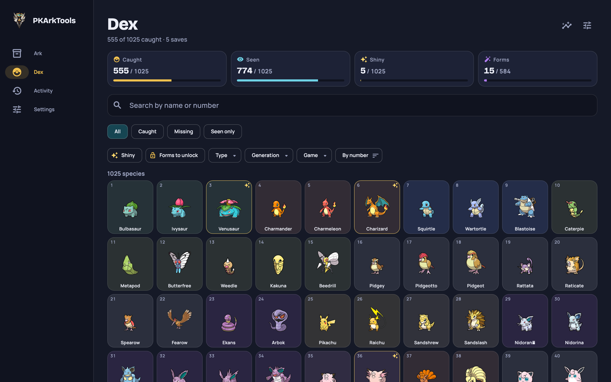

Solo muestra **datos objetivos** (tipos, estadísticas base, habilidades,
género, evoluciones, formas, juegos) y lo que hay en tus partidas. No incluye
descripciones de la Pokédex ni arte oficial: los iconos son los mismos que en
el resto de la app, descargados bajo demanda ([Iconos](iconos.md)). Sin
iconos, la Dex funciona igual (se ven los números).

## Cuadrícula

Cada especie es una casilla con su número, icono y nombre:

| Aspecto | Significado |
|---|---|
| Silueta gris y «—» | **Sin registrar** en ninguna partida. |
| Icono en gris, atenuado | **Vista**: alguna Pokédex la marca como vista (o solo tienes un huevo). |
| Icono a color, fondo del color de su tipo | **Capturada**: alguna Pokédex la marca capturada o tienes un ejemplar. |
| Borde dorado y ✦ | Tienes **algún ejemplar variocolor**. |

Arriba están las cifras: **Capturados N/1025**, **Vistos**, **Variocolor**
(especies de las que tienes un ejemplar variocolor) y **Formas** (formas
alternativas con ejemplar + variantes de formas especiales desbloqueadas,
sobre el total). Tocar una cifra o el icono de gráfica abre el **Progreso**.

## Filtros y búsqueda

* **Estado**: Todos, Capturados, Faltantes, Solo vistos.
* **Variocolor**: especies con algún ejemplar variocolor.
* **Formas por desbloquear**: especies con alguna forma alternativa sin
  ejemplar o alguna forma especial (normal o variocolor) bloqueada.
* **Tipo** (en cualquiera de sus formas), **Generación** (= región de origen)
  y **Juego** (solo las especies que existen en ese juego, con el estado de
  tus partidas de ese juego).
* **Buscador** por nombre (español o inglés, sin importar acentos) o número
  (`25`, `#025`), y **orden** por número o por nombre.

  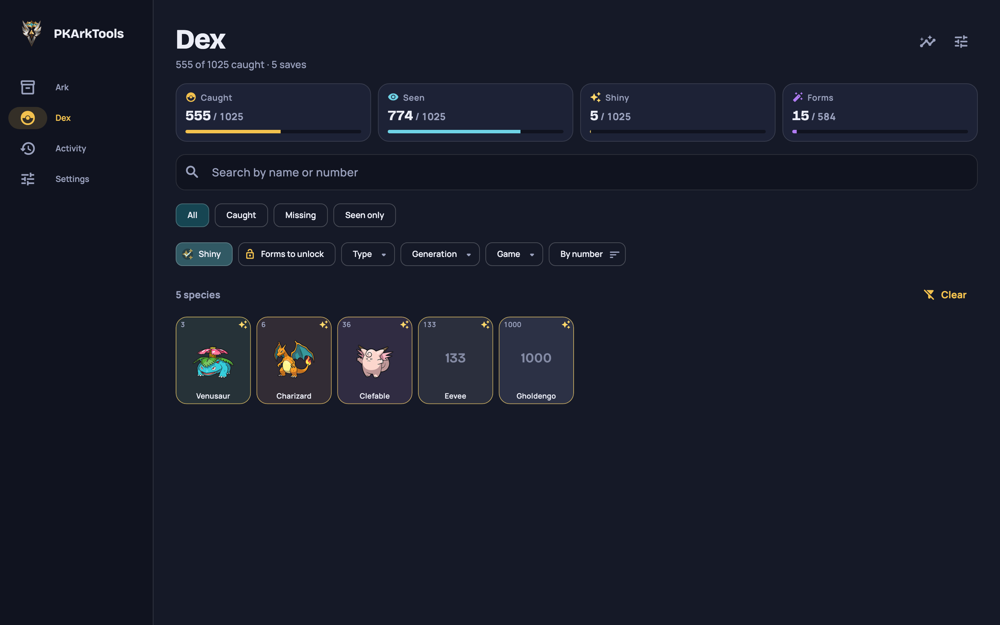

## Ficha de especie

Al tocar una casilla se abre su ficha (con ‹ › pasas a la anterior o la
siguiente):

* **Tipos, estadísticas base, habilidades** (la oculta, marcada) y **ratio de
  género** de la forma elegida, con los datos del juego más reciente en el que
  existe esa forma.
* **Evolución**: la familia completa con el método de cada paso (nivel,
  objeto, amistad, intercambio, hora del día, movimiento, lugar…), sacada de
  las tablas de evolución de PKHeX. Toca un Pokémon para ir a su ficha.
* **Formas**: las formas que un Pokémon puede tener en una caja (regionales,
  Rotom, Unown, Vivillon…), con sus tipos; ✓ si tienes un ejemplar de esa
  forma. Toca una para ver sus estadísticas y habilidades.
* **Formas especiales**: ver abajo.
* **Juegos donde aparece**, resaltando los que tienes en el Arca.
* **Tus registros**: en qué partidas está vista o capturada (✦ si esa Pokédex
  la registra variocolor). Toca una para abrir la partida.
* **Tus ejemplares**: cada Pokémon concreto en equipos y cajas (juego,
  entrenador, apodo, nivel, forma, variocolor, factor Gigamax y hueco). Al
  tocarlo se abre la partida **en esa caja con el Pokémon resaltado**.

No hay grupo huevo: no hay una tabla verificada de grupos huevo en el
proyecto, y la Dex solo muestra datos comprobados.

  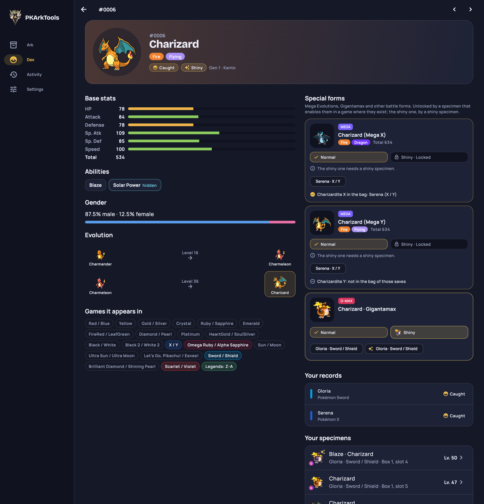

## Formas especiales desbloqueables

Las Megaevoluciones, Gigamax y otras formas de combate no existen en una caja:
la Dex las muestra como formas de la especie que **se desbloquean** con un
ejemplar que las habilite **en un juego donde existen**. Cada una tiene dos
variantes, **normal** y **variocolor**, que se desbloquean por separado: un
ejemplar normal desbloquea la normal y uno variocolor, la variocolor.

Las bloqueadas se ven como silueta con un candado y la explicación de cómo se
desbloquean. Las desbloqueadas muestran qué ejemplares lo hacen (tócalos para
ir a su caja).

  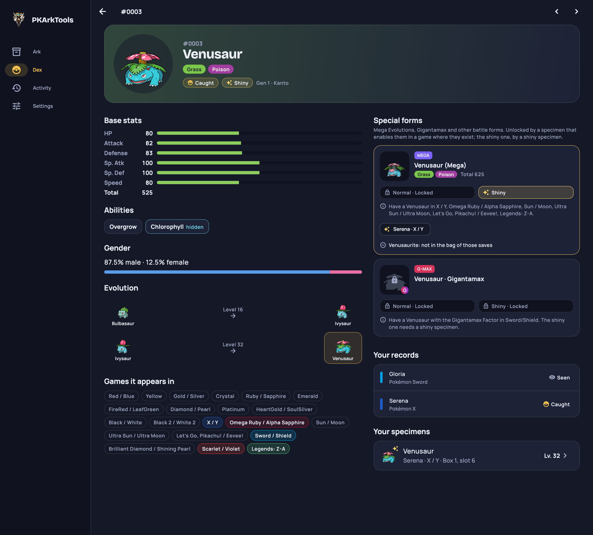
  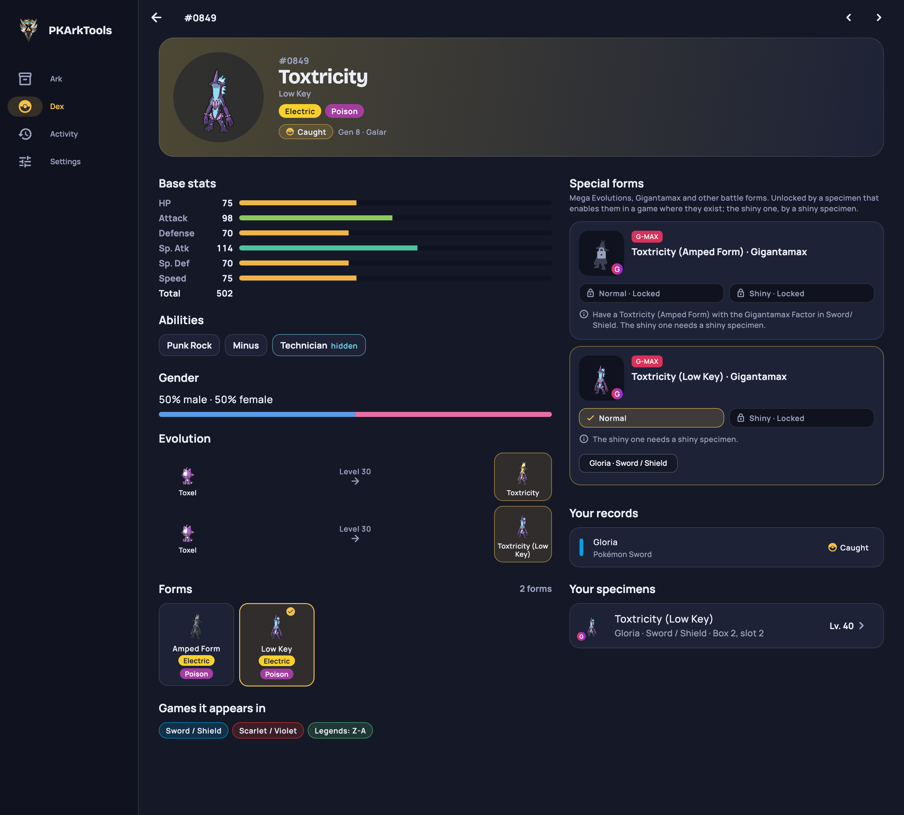

### Reglas

| Forma | Se desbloquea con | Juegos | Indicador (no requisito) |
|---|---|---|---|
| **Megaevolución** | Un ejemplar de la especie (no huevo) en una partida de un juego con esa Mega | X/Y, Rubí Omega/Zafiro Alfa, Sol/Luna, Ultrasol/Ultraluna, Let's Go (solo las Megas de Kanto) y Leyendas Z-A (su lista propia, incluidas las nuevas de Z-A y de Mega Dimensión) | Su **megapiedra** en el inventario de esa partida (o equipada) |
| Megas de una forma concreta | El ejemplar tiene que ser de esa forma: Floette Flor Eterna, Meowstic ♂/♀, Magearna (normal u Original), Tatsugiri (cada forma), Raichu (de Kanto, no de Alola) | Leyendas Z-A | Su megapiedra |
| Mega Rayquaza | Un Rayquaza | ROZA, SL, USUL, Z-A | — (Ascenso del Dragón, sin piedra) |
| **Regresión primigenia** | Un Kyogre o Groudon | ROZA, SL, USUL, Z-A | Prisma Azul / Prisma Rojo |
| **Ultraexplosión** (Ultra Necrozma) | Un Necrozma **fusionado** (Melena Crepuscular o Alas del Alba) | Ultrasol/Ultraluna | Ultranecrostal Z |
| **Gigamax** | Un ejemplar de la especie con el **factor Gigamax** activado (PK8 `CanGigantamax`) | Espada/Escudo | — |
| Gigamax por forma | Urshifu (Golpe Único / Fluido) y Toxtricity (Aguda / Grave) tienen una Gigamax por forma; Pikachu y Meowth solo la de su forma normal | Espada/Escudo | — |
| Eternamax | **No se desbloquea**: ningún ejemplar la habilita | — | — |

Ejemplo: un Charizard variocolor con factor Gigamax en Espada desbloquea la
**Gigamax variocolor** de Charizard; si además tienes un Charizard normal con
factor, también la **normal**. Un Charizard en X/Y desbloquea Mega Charizard X
e Y (normales), y la ficha indica si la Charizardita X/Y está en la mochila de
esa partida.

Un ejemplar fuera de esos juegos no desbloquea nada (un Charizard con factor
Gigamax llevado a Escarlata/Púrpura vía HOME no cuenta: Gigamax no existe
allí), y los huevos no cuentan.

Las reglas están en **una tabla de datos** en el código
(`packages/pkcore/lib/src/dex/special_forms.dart`, `SpecialForms.all`): qué
forma, en qué juegos, desde qué formas base, con qué objeto y si necesita el
factor Gigamax. La lista de Megas por juego, sus objetos y las especies con
Gigamax se comprueban contra PKHeX (`special_forms_oracle.csv`, generado por el
oráculo con `tool/gen_dex_tables.sh`).

## Progreso

El icono de gráfica abre el progreso: las cifras globales, el desglose **por
generación y región** (con los variocolor de cada una) y **por juego** (de las
especies que existen en ese juego, cuántas tienes capturadas y vistas en tus
partidas de ese juego). Tocar una fila abre la cuadrícula filtrada.

  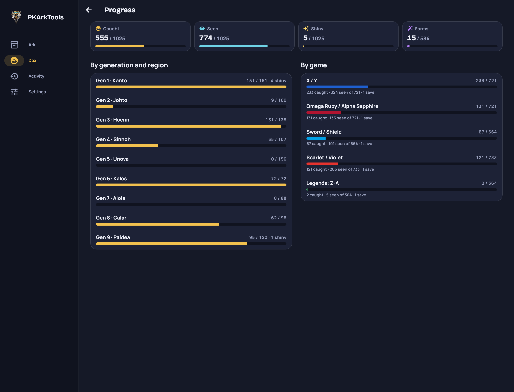

## Living dex

En **Ajustes de la Dex** (icono de ajustes de la pestaña) puedes activar la
**living dex**: una especie cuenta como capturada **solo si tienes un
ejemplar** (no huevo) en el equipo o las cajas de alguna partida, no solo si
alguna Pokédex la registra. Así se ve lo que de verdad te falta (filtro
**Faltantes**). La opción se guarda en este dispositivo.

## Rendimiento y datos

* La Dex se calcula **en segundo plano** al reindexar o importar: cada copia
  se lee una sola vez (Pokédex, ejemplares y activadores del inventario) y el
  resultado se guarda en el **índice local** (por SHA-256 de la copia). Solo se
  leen las copias nuevas.
* Al abrir la pestaña solo se cruza esa caché: con 50 partidas, unos 10 ms.
* Se usa la **copia más reciente** de cada partida.
* No necesita internet (salvo para descargar iconos, si lo activas).

  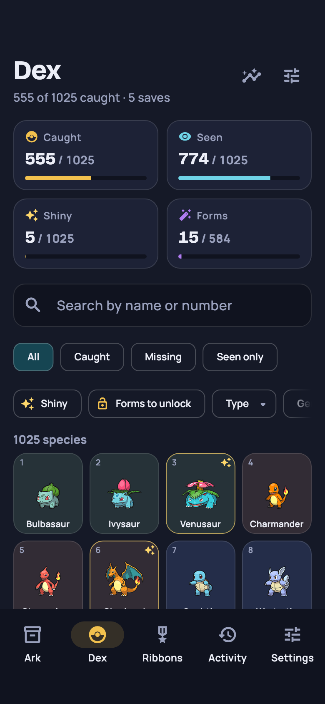
  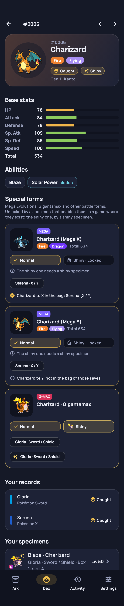

En Android (emulador) y iPhone (simulador):

  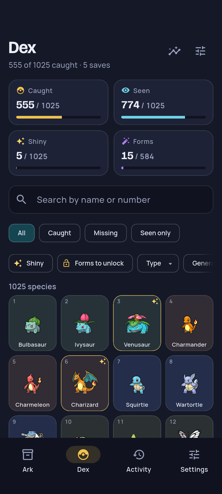
  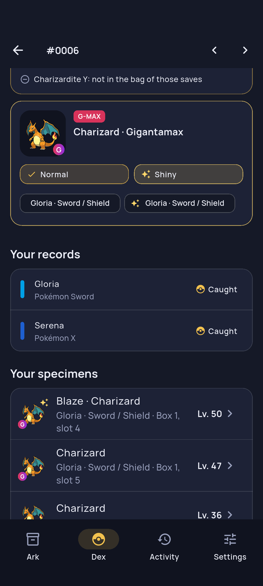
  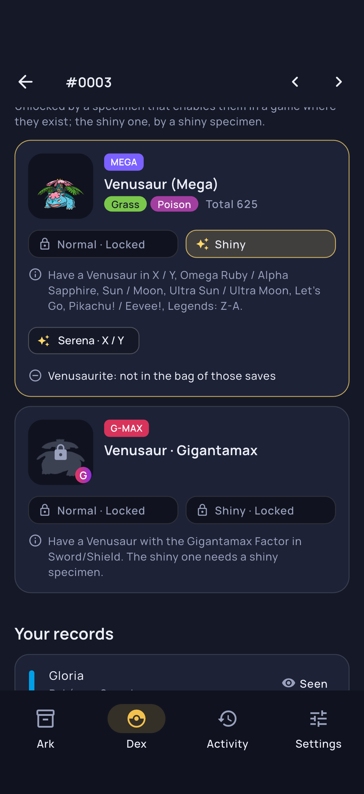
  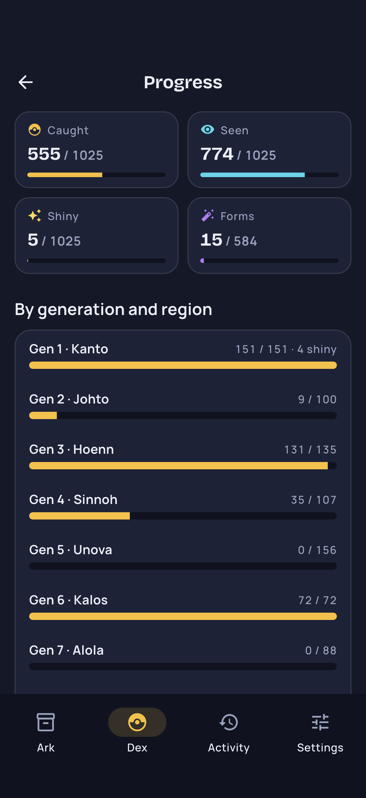

Más capturas

  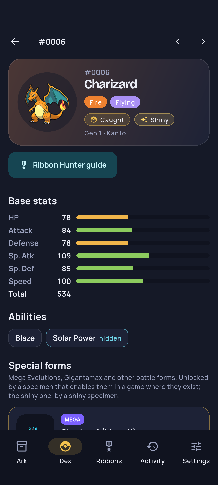
  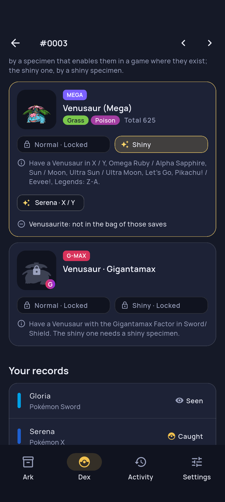
  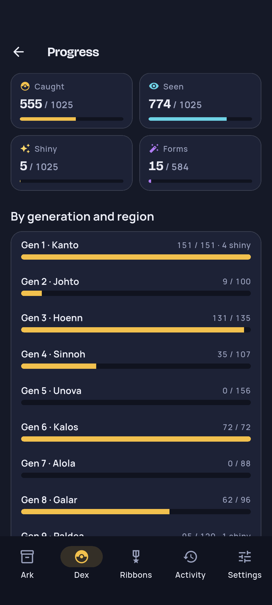
  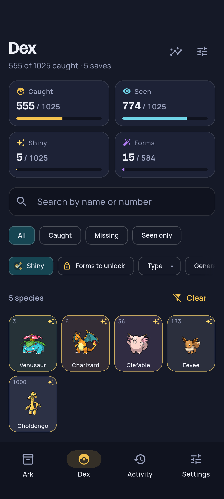
  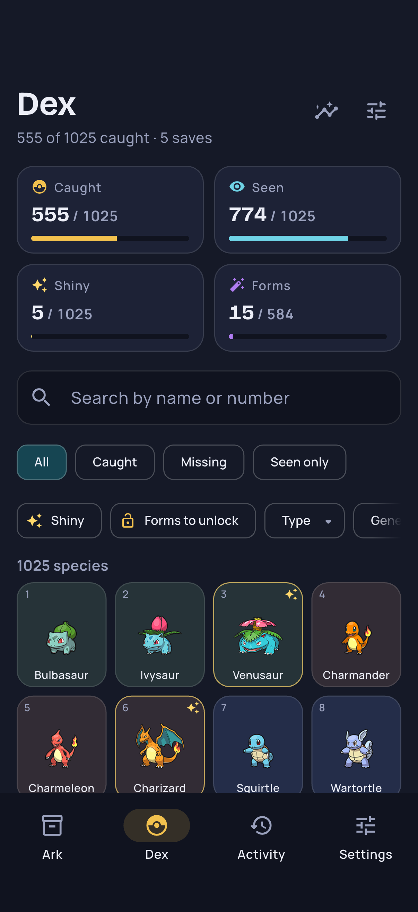
  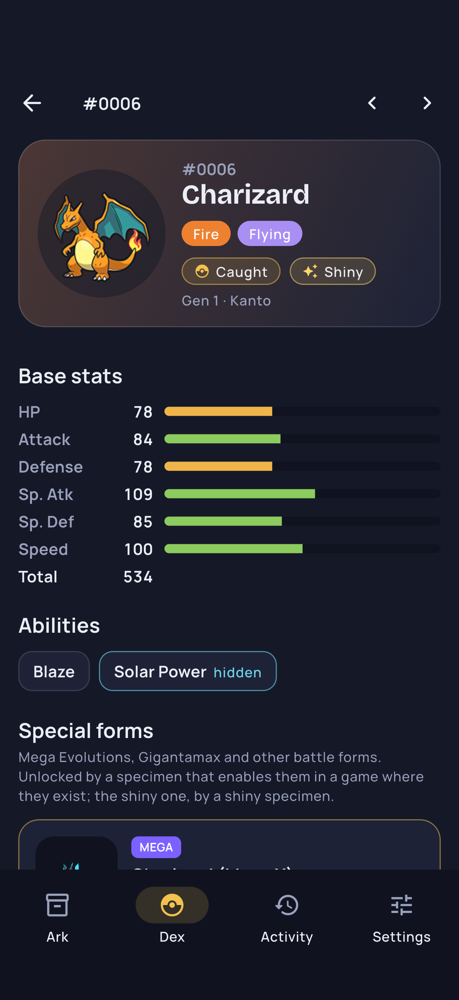
  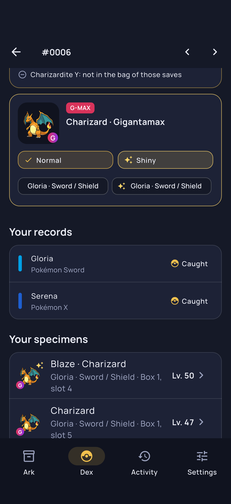
  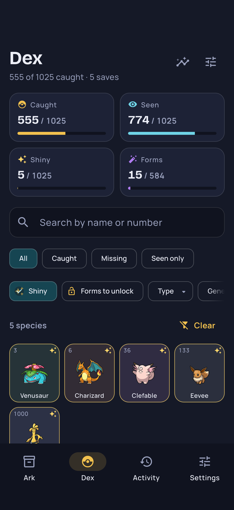

