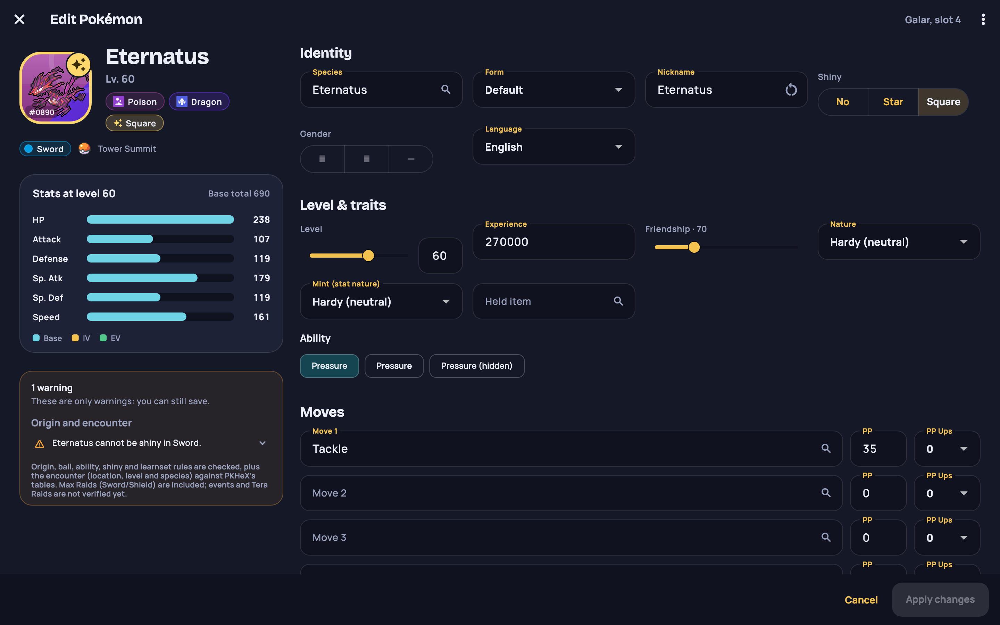

# Iconos

Los iconos (sprites) de Pokémon —normal, variocolor, formas, género cuando
difiere y huevo—, objetos, Poké Balls, tipos y cintas aparecen en el equipo,
las cajas, el editor, la Pokédex, el inventario, la comparación y la
legalidad.

  
  

## De dónde salen

**No vienen dentro de la app.** Se descargan bajo demanda de los recursos del
repositorio de PKHeX en GitHub (`raw.githubusercontent.com`, fijados a un
commit concreto) y se guardan en el **directorio de caché de la app** (nunca en
la carpeta del Arca). Es la única conexión a internet que hace la app y no
envía ningún dato tuyo. Los sprites son © Nintendo / Game Freak / The Pokémon
Company.

Sin conexión, o si una descarga falla, se muestra un avatar con las iniciales
y se reintenta más tarde.

## Ajustes › Iconos

* Tamaño de la caché y de la descarga completa.
* **Descargar todos los iconos** (~2,2 MB, unos 3500 archivos; menos de
  30 s con buena conexión): útil antes de quedarte sin conexión. Empieza por
  los Pokémon de tus saves, muestra archivos y MB, se puede cancelar y, si se
  corta, la siguiente vez continúa donde se quedó. Sin conexión avisa enseguida.
* **Borrar caché de iconos**: libera el espacio; se volverán a descargar al
  verlos.

Hay límites de tamaño por archivo (512 KB) y en total (64 MB).

Siguiente: [Preguntas frecuentes](faq.md).
