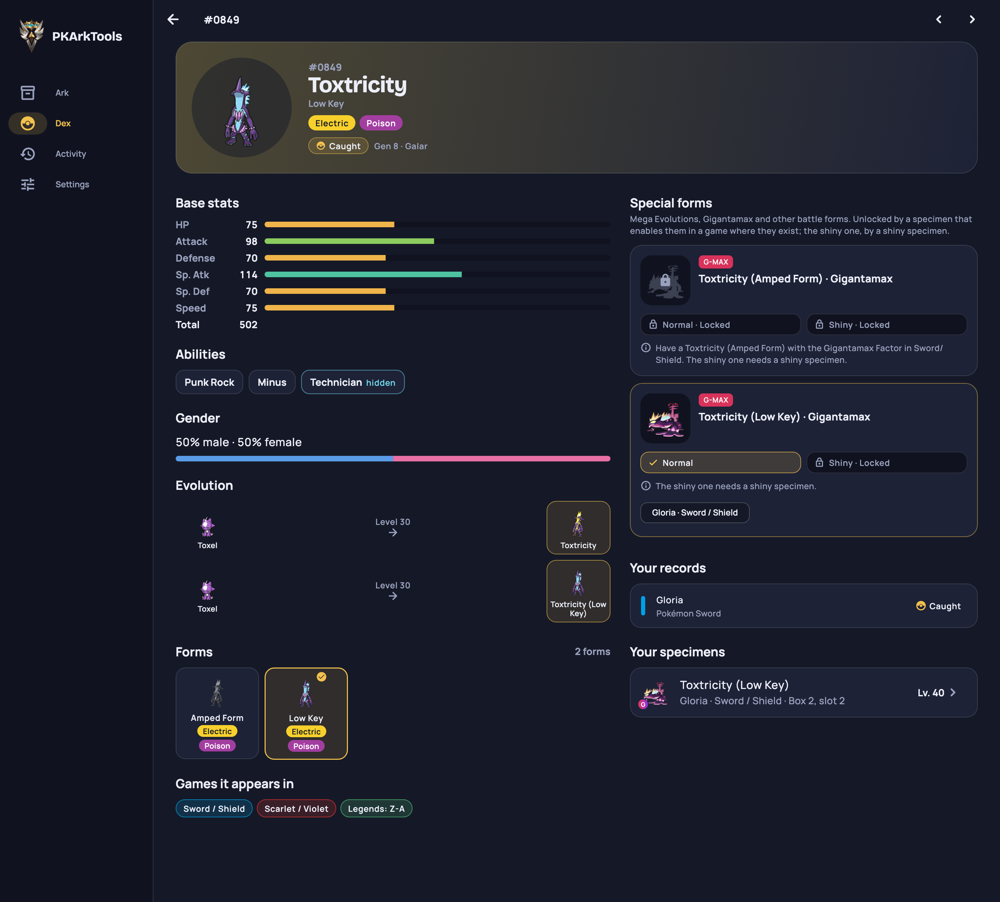
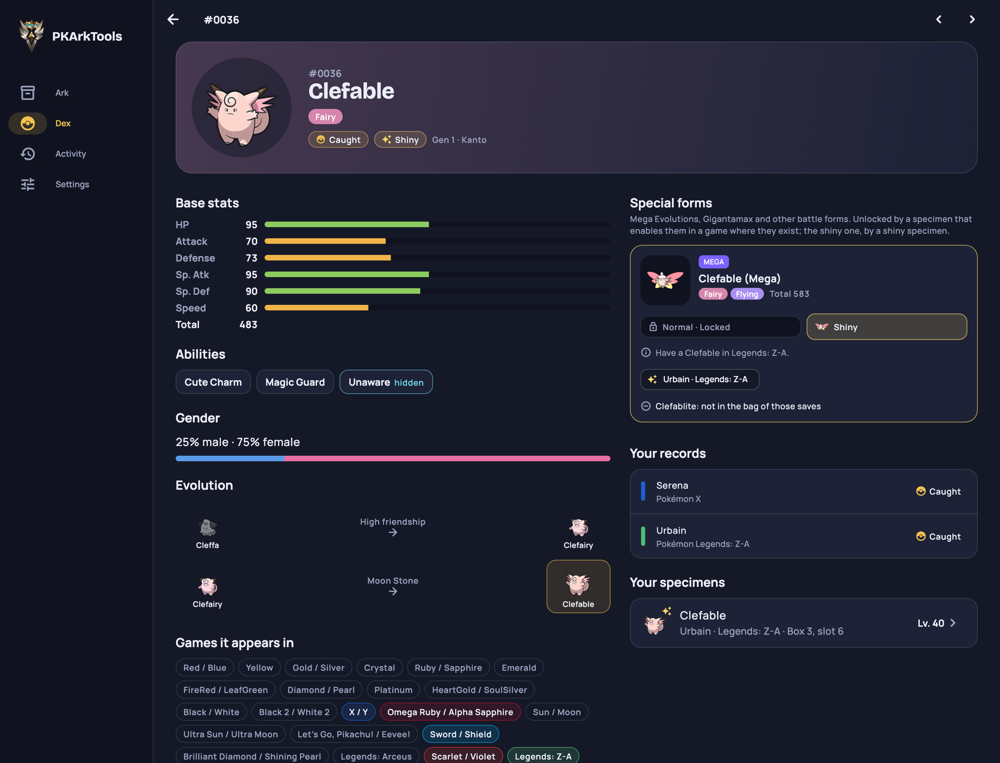
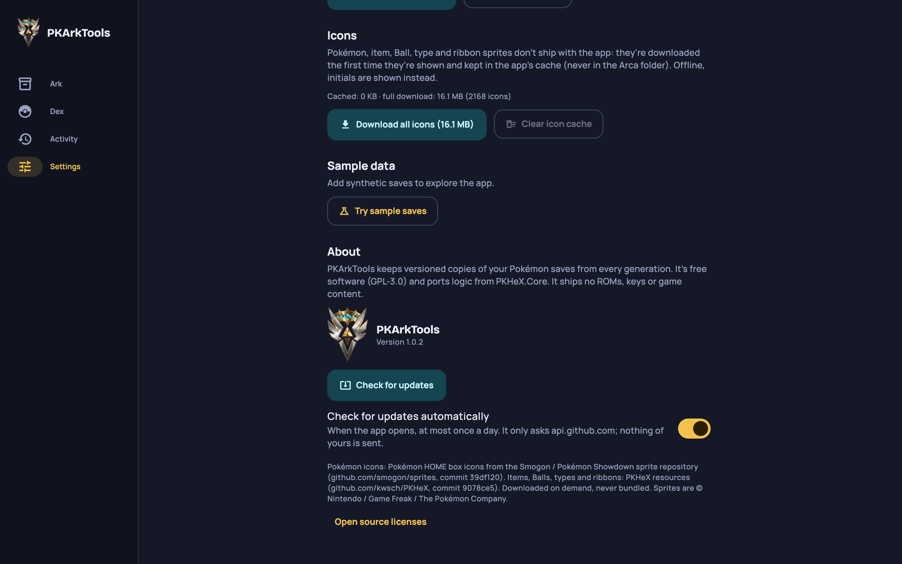

# Iconos

Los iconos (sprites) de Pokémon —las 1025 especies hasta Escarlata/Púrpura,
sus DLC y Leyendas Z-A, formas regionales y alternativas, hembra cuando difiere
y huevo—, objetos, Poké Balls, tipos y cintas aparecen en el equipo,
las cajas, el editor, la Pokédex, el inventario, la comparación y la
legalidad.

  
  

## De dónde salen

**No vienen dentro de la app.** Se descargan bajo demanda de GitHub
(`raw.githubusercontent.com`, cada fuente fijada a un commit concreto) y se
guardan en el **directorio de caché de la app** (nunca en la carpeta del Arca).
Es la única conexión a internet que hace la app y no envía ningún dato tuyo.

| Iconos | Fuente |
| --- | --- |
| Pokémon (1025 especies, 330 formas, huevo) | Iconos de caja de **Pokémon HOME** del repositorio de sprites de Smogon / Pokémon Showdown ([smogon/sprites](https://github.com/smogon/sprites), `src/minisprites/pokemon/home`) |
| Formas especiales que esa carpeta no tiene y su variocolor | El **mismo repositorio y commit**: volcado de los iconos de caja de HOME (`src/_uncategorized/canonical/home/small` y `small-shiny`), iconos de **Pokémon Champions** (`src/champions`) y renders de HOME (`src/previews/gen9`). Solo se descargan los archivos que usa la app (236). |
| Objetos, Poké Balls, tipos y cintas | Recursos de [PKHeX](https://github.com/kwsch/PKHeX) |

**Ajustes › Acerca de** muestra ambas fuentes con su commit. Los sprites son
© Nintendo / Game Freak / The Pokémon Company.

* **Formas**: las que tienen icono propio en HOME (regionales, Rotom, Vivillon,
  Ogerpon, Tauros de Paldea, Urshifu…) se ven con él, también los tipos de
  Silvally y la Teraforma y forma Astral de Terapagos.
* **Formas especiales de la Dex**: todas las de la tabla de formas especiales
  tienen icono propio, normal y variocolor (ver la tabla de abajo). Se ven en
  sus tarjetas de la ficha (en silueta si están bloqueadas) y, en «Tus
  ejemplares», un Pokémon con el factor Gigamax se dibuja Gigamax (con la
  insignia «G»).
* **Variocolor**: solo las formas especiales tienen icono variocolor propio
  (la tarjeta lo muestra en «Variocolor» cuando está desbloqueada). El resto
  de Pokémon variocolor lleva el borde dorado y la insignia ✦.
* **Tamaño**: todos los Pokémon se dibujan a la misma escala, la que hace que
  un icono típico llene casi todo el hueco (88 %), sin recortarse ni
  deformarse. Los objetos y Balls son arte de píxeles y se amplían sin
  suavizar.

  

## Formas especiales

| Forma | Cuántas | Icono normal | Variocolor |
| --- | --- | --- | --- |
| Megas de X/Y y Rubí Omega/Zafiro Alfa (también las de Let's Go) | 48 | Iconos de HOME (`minisprites/pokemon/home`) | Volcado de HOME (`small-shiny`) |
| Megas de Leyendas Z-A y Mega Dimensión | 49 | Pokémon Champions (40); renders de HOME (9: Heatran, Darkrai, Zygarde, Magearna ×2, Zeraora, Tatsugiri ×3) | Igual, versión «-s» |
| Primigenias (Kyogre, Groudon) | 2 | Iconos de HOME | Volcado de HOME |
| Ultra Necrozma | 1 | Iconos de HOME | Volcado de HOME |
| Gigamax | 34 | Volcado de HOME (25); renders de HOME (9: Venusaur, Blastoise, Rillaboom, Cinderace, Inteleon, Appletun, Toxtricity Grave, Urshifu Brusco y Fluido) | Igual, variocolor |

  
  

Las 134 formas especiales tienen icono propio normal y variocolor. Toxtricity
y Urshifu tienen una Gigamax por forma; Alcremie, una sola para todas sus
formas.

Si en el futuro una forma especial no tuviera icono en la fuente, la tarjeta
usaría el de la especie con una insignia clara (**G**, **MEGA**, **P**,
**ULTRA**) en vez de parecer un error.

### Sin icono propio en ninguna fuente fiable

Estas formas usan el icono de la especie (tienen el mismo aspecto en HOME o no
existen en él):

* **Koraidon** y **Miraidon**: sus cuatro modos de montura de
  Escarlata/Púrpura (formas 1–4); ninguna fuente pública tiene sus iconos de
  caja.
* **Pichu picoreja** (HeartGold/SoulSilver): no existe en HOME.
* **Eevee y Pikachu compañeros** de Let's Go, **Rockruff** con Ritmo Propio,
  **Zygarde** 50 % con Agrupamiento, **Mothim** de Leyendas Arceus y las
  formas de **Scatterbug**/**Spewpa**: mismo aspecto que la forma normal.
* Formas que no se guardan en las cajas (Dominantes de Sol/Luna, Señoriales de
  Leyendas Arceus, Mimikyu descubierto, Ogerpon teracristalizado), que la Dex
  no muestra.

Sin conexión, o si una descarga falla, se muestra un avatar con las iniciales
y se reintenta más tarde.

## Ajustes › Iconos

* Tamaño de la caché y de la descarga completa.
* **Descargar todos los iconos** (~22 MB, unos 2400 archivos; menos de un
  minuto con buena conexión): útil antes de quedarte sin conexión. Empieza por
  los Pokémon de tus saves, muestra archivos y MB, se puede cancelar y, si se
  corta, la siguiente vez continúa donde se quedó. Sin conexión avisa enseguida.
* **Reparar iconos**: vuelve a descargar solo los que falten o estén dañados
  (vacíos, cortados o de otro tamaño que el del índice), también los de las
  formas especiales.
* **Borrar caché de iconos**: libera el espacio; se volverán a descargar al
  verlos.

Hay límites de tamaño por archivo (512 KB) y en total (64 MB).

Siguiente: [Preguntas frecuentes](faq.md).
