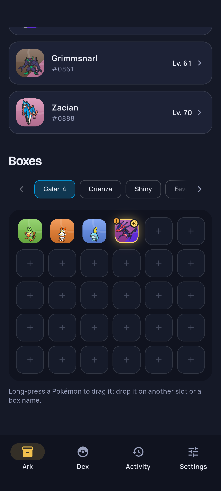
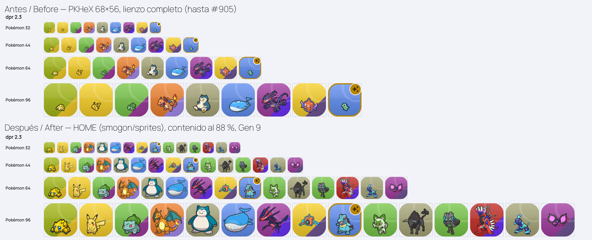

# Iconos

Los iconos (sprites) de Pokémon —las 1025 especies hasta Escarlata/Púrpura,
sus DLC y Leyendas Z-A, formas regionales y alternativas, hembra cuando difiere
y huevo—, objetos, Poké Balls, tipos y cintas aparecen en el equipo,
las cajas, el editor, la Pokédex, el inventario, la comparación y la
legalidad.

  
  

## De dónde salen

**No vienen dentro de la app.** Se descargan bajo demanda de GitHub
(`raw.githubusercontent.com`, cada fuente fijada a un commit concreto) y se
guardan en el **directorio de caché de la app** (nunca en la carpeta del Arca).
Es la única conexión a internet que hace la app y no envía ningún dato tuyo.

| Iconos | Fuente |
| --- | --- |
| Pokémon (1025 especies, 330 formas, huevo) | Iconos de caja de **Pokémon HOME** del repositorio de sprites de Smogon / Pokémon Showdown ([smogon/sprites](https://github.com/smogon/sprites), `src/minisprites/pokemon/home`) |
| Objetos, Poké Balls, tipos y cintas | Recursos de [PKHeX](https://github.com/kwsch/PKHeX) |

**Ajustes › Acerca de** muestra ambas fuentes con su commit. Los sprites son
© Nintendo / Game Freak / The Pokémon Company.

* **Formas**: las que tienen icono propio en HOME (regionales, Rotom, Vivillon,
  Ogerpon, Tauros de Paldea, Urshifu…) se ven con él; las que no (megas nuevas
  de Leyendas Z-A, Teraforma de Terapagos, tipos de Silvally, modos de
  Koraidon/Miraidon…) usan el icono de la especie.
* **Variocolor**: la fuente no tiene iconos variocolor de HOME, así que el
  Pokémon variocolor lleva el borde dorado y la insignia ✦.
* **Tamaño**: todos los Pokémon se dibujan a la misma escala, la que hace que
  un icono típico llene casi todo el hueco (88 %), sin recortarse ni
  deformarse. Los objetos y Balls son arte de píxeles y se amplían sin
  suavizar.

  

Sin conexión, o si una descarga falla, se muestra un avatar con las iniciales
y se reintenta más tarde.

## Ajustes › Iconos

* Tamaño de la caché y de la descarga completa.
* **Descargar todos los iconos** (~17 MB, unos 2200 archivos; menos de un
  minuto con buena conexión): útil antes de quedarte sin conexión. Empieza por
  los Pokémon de tus saves, muestra archivos y MB, se puede cancelar y, si se
  corta, la siguiente vez continúa donde se quedó. Sin conexión avisa enseguida.
* **Reparar iconos**: vuelve a descargar solo los que falten o estén dañados
  (vacíos, cortados o de otro tamaño que el del índice).
* **Borrar caché de iconos**: libera el espacio; se volverán a descargar al
  verlos.

Hay límites de tamaño por archivo (512 KB) y en total (64 MB).

Siguiente: [Preguntas frecuentes](faq.md).
