# Importar saves

Pulsa **Importar** (en teléfono, el botón flotante; en escritorio, la barra
superior del Arca) y elige una de las dos opciones de **Añadir al Arca**.

## Importar archivo

Saves de cartucho o exportados: `.sav`, `.srm`, `.dsv`, `main`… Puedes elegir
varios a la vez. Cada archivo se identifica por su contenido (tamaño,
estructura y checksums), no por su extensión. Si no se reconoce, el mensaje
explica por qué (tamaño, sectores, hash…).

El archivo original **solo se lee**: el Arca guarda una copia byte a byte.

## Importar carpeta

Elige una carpeta y la app busca saves dentro, incluidas las subcarpetas.
Antes de importar verás un resumen: detectados por juego, ya presentes en el
Arca, repetidos dentro de la selección, no reconocidos y archivos ignorados.

Nunca se abren ROMs, claves ni paquetes de juego: las extensiones `.nsp`,
`.xci`, `.nca`, `.keys`, `.gba`, `.nds`, `.3ds`, `.cia`, `.zip`, imágenes,
etc. se descartan sin leerlas.

La app recuerda la ruta de origen de cada copia para poder **restaurarla en el
mismo sitio** (ver [El Arca](arca.md#restaurar)).

Los equipos en texto de Pokémon Showdown se
importan desde la partida (ver [Herramientas](herramientas.md#pokémon-showdown)).

## Fuentes habituales

### Checkpoint y JKSM (3DS y Switch con homebrew)

Copia a tu ordenador o teléfono la carpeta de Checkpoint
(`/3ds/Checkpoint/saves/…` o `/switch/Checkpoint/saves/…`) o de JKSM y usa
**Importar carpeta** sobre ella: se reconocen los exports de ambos.

### Emuladores de Game Boy, GBA y DS

Los `.sav`/`.srm` crudos, los `.dsv` de DeSmuME y los saves con «pie RTC»
(reloj) que añaden algunos emuladores de GB/GBA se reconocen; al exportar se
conserva el mismo contenedor para que el emulador lo vuelva a cargar.

### GameCube: Pokémon Colosseum y XD (Dolphin)

PKArkTools lee el save de tres formas; elige la que te resulte más cómoda:

1. **`.gci` exportado** (recomendado). En Dolphin: **Herramientas ›
   Administrar tarjetas de memoria**, elige la tarjeta (Ranura A), selecciona
   el save de «Pokémon Colosseum» o «Pokémon XD» y pulsa **Exportar GCI**.
   Importa ese `.gci`. Para devolverlo, en la misma ventana usa **Importar
   GCI** (borra antes la copia vieja, la tarjeta no admite dos iguales).
   Pokémon Box: Rubí y Zafiro se exporta igual (código `GPXE`/`GPXP`/`GPXJ`).
2. **Carpeta GCI de Dolphin**. Si en **Configuración › GameCube** la Ranura A
   es «Carpeta GCI», los saves están ya como `.gci` en
   `User/GC/<USA|EUR|JAP>/Card A/` (en Android,
   `Android/data/org.dolphinemu.dolphinemu/files/GC/…`, accesible por el
   selector del sistema desde el gestor de archivos de Dolphin o copiándolo
   por USB). Importa el archivo o la carpeta; para devolver el save editado,
   reemplaza ese `.gci` con Dolphin cerrado.
3. **Imagen completa de la Memory Card** (`MemoryCardA.USA.raw` en
   `User/GC/`, o `.gcp`/`.mci` de otras herramientas). Si la tarjeta solo
   tiene un save de Pokémon, el archivo exportado es la tarjeta entera con el
   save editado en su sitio (el resto de juegos no cambia). Si tiene
   Colosseum y XD, se importa cada uno como su `.gci`.

En una GameCube o Wii real, copia el save a una tarjeta SD con
GCMM (homebrew) como `.gci` o `.raw` e impórtalo igual.

Los Pokémon sueltos de estos juegos son `.ck3` (Colosseum) y `.xk3` (XD);
también se puede importar un `.pk3` de GBA, que se convierte con la región
del save. Un Pokémon oscuro sin purificar no se puede llevar a un juego de
GBA (igual que en el juego).

  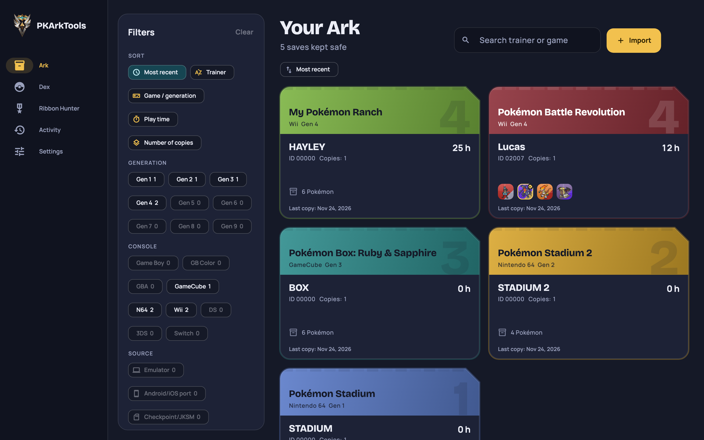
  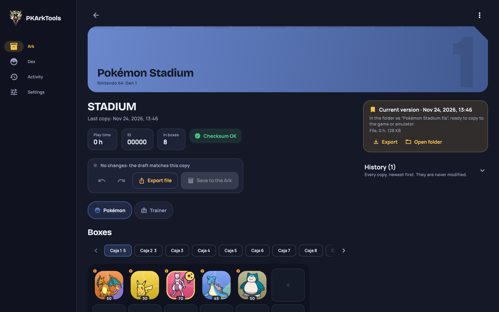
  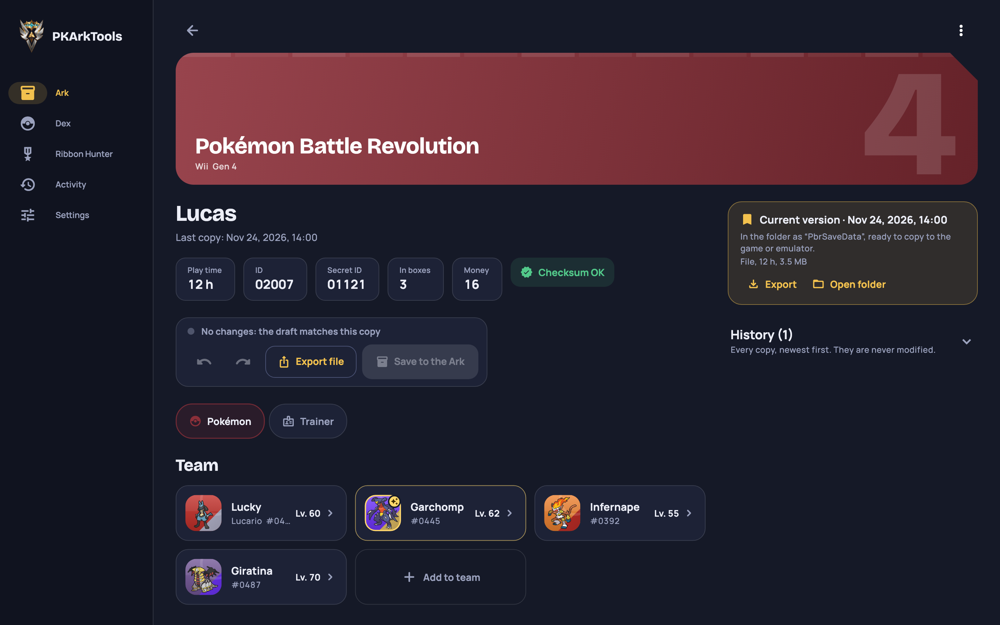

  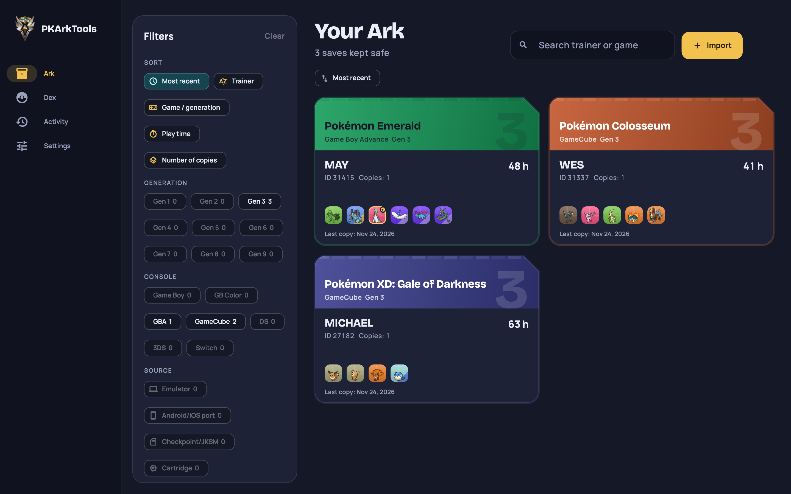
  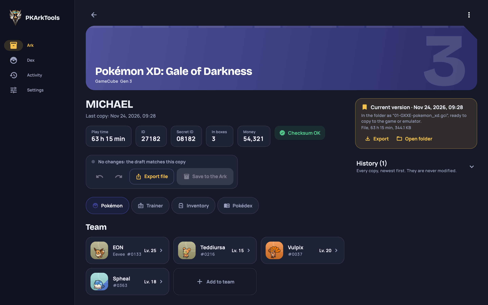
  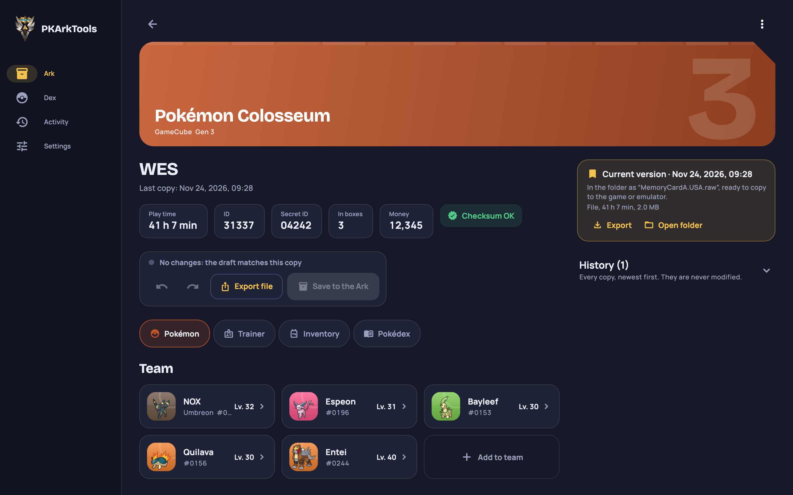

En Android:

  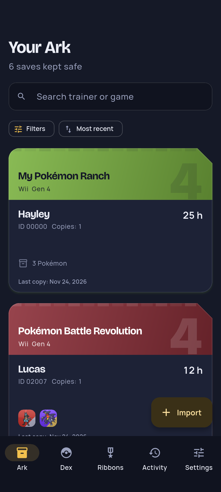
  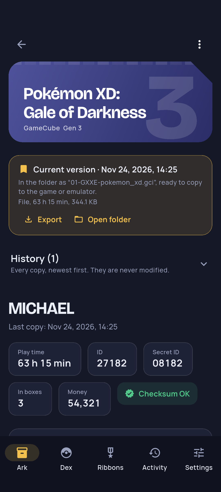
  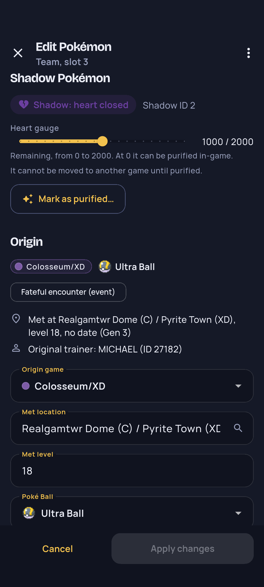
  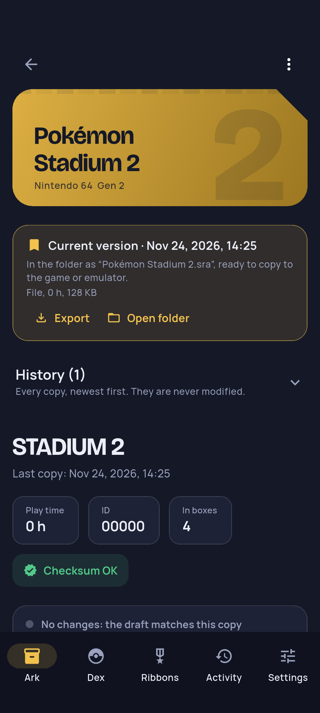
  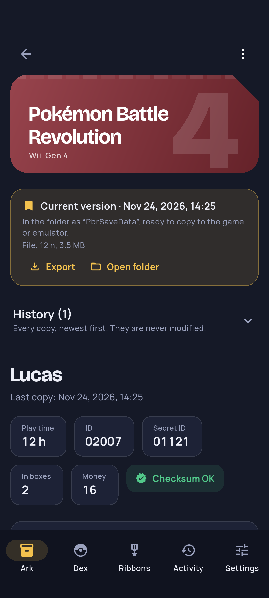

### Nintendo 64: Pokémon Stadium y Stadium 2

El save va en el cartucho. Con un emulador, importa el archivo de save del
juego: `.fla` (FlashRAM, Stadium) o `.sra` (SRAM, Stadium 2) en la carpeta
`save` de **Mupen64Plus** / **simple64**, en `Save/` de **Project64** o el
`.srm` de **RetroArch**. Con un cartucho real, vuelca el save con un lector
(GB Operator, Retrode, Sanni Cart Reader…). Los volcados con el orden de bytes
invertido se reconocen y se exportan igual. Los Pokémon que guarda Stadium en
sus cajas se ven y se editan; los equipos registrados de cada copa, en solo
lectura.

### Wii: Battle Revolution y My Pokémon Ranch (Dolphin)

Dolphin guarda los saves de Wii descifrados en su NAND:
`User/Wii/title/00010000/<id>/data/`, con **PbrSaveData** (Battle Revolution,
id `52504245`/`52504250`/`5250424a`) y **pokemonranch.bin** (My Pokémon Ranch).
Importa ese archivo y, para devolverlo, cópialo encima con Dolphin cerrado. En
una Wii real, copia el save a la SD desde **Ajustes de Wii › Gestor de datos**,
impórtalo en Dolphin (**Herramientas › Importar save de Wii**) y toma el archivo
de la NAND; el camino inverso es **Exportar save de Wii**.

### Emuladores de Switch en escritorio

Elige la carpeta de saves del emulador, por ejemplo `nand/user/save/…` en
Yuzu/Eden/Sudachi/Citron o `bis/user/save` en Ryujinx. Se reconoce el archivo
`main` de cada juego.

### Android

**Importar carpeta** usa el selector del sistema (SAF). La app nunca pide
permiso de acceso a todo el almacenamiento.

* **Emuladores que guardan en una carpeta normal** (por ejemplo, una carpeta
  elegida por ti en el almacenamiento interno o en la tarjeta SD): elígela
  directamente.
* **Ports de emuladores de Switch y otras apps que guardan en
  `Android/data/<paquete>`**: desde Android 11 el sistema **no deja** que
  ninguna app elija `Android/data` con el selector. Opciones:
  1. Si el emulador aparece en la barra lateral del selector (algunos, como los
     derivados de Yuzu, publican su propia carpeta de datos como «proveedor de
     documentos»), elige ahí `nand/user/save/…`.
  2. Usa la función **exportar / importar datos de guardado** del propio
     emulador hacia una carpeta normal (Descargas, Documentos) e importa desde
     ella.
  3. Conecta el teléfono a un ordenador y copia la carpeta de saves.
  Para devolver el save editado haz el camino inverso: **Exportar archivo**
  a una carpeta normal y usa la importación del emulador.

### iOS / iPadOS

El selector de archivos de iOS ve iCloud Drive, «En mi iPhone» y los
proveedores instalados (Google Drive, Dropbox…). Un emulador cuyos saves estén
dentro de su propio contenedor solo es accesible si comparte su carpeta en la
app Archivos o si permite exportar el save; en ese caso exporta/comparte el
archivo a Archivos e impórtalo desde ahí.

## Pokémon sueltos

Dentro del editor de cajas puedes **importar** y **exportar** Pokémon sueltos
del formato del juego (`.pk1` … `.pk9`, `.pb7`, `.pb8`, `.pa8`, `.pa9`;
`.ck3`/`.xk3` en Colosseum/XD, `.sk2` en Stadium 2, `.bk4` en Battle Revolution y
`.rk4` en el Rancho). Ver
[Editor](editor.md#cajas).

Siguiente: [El Arca](arca.md).
