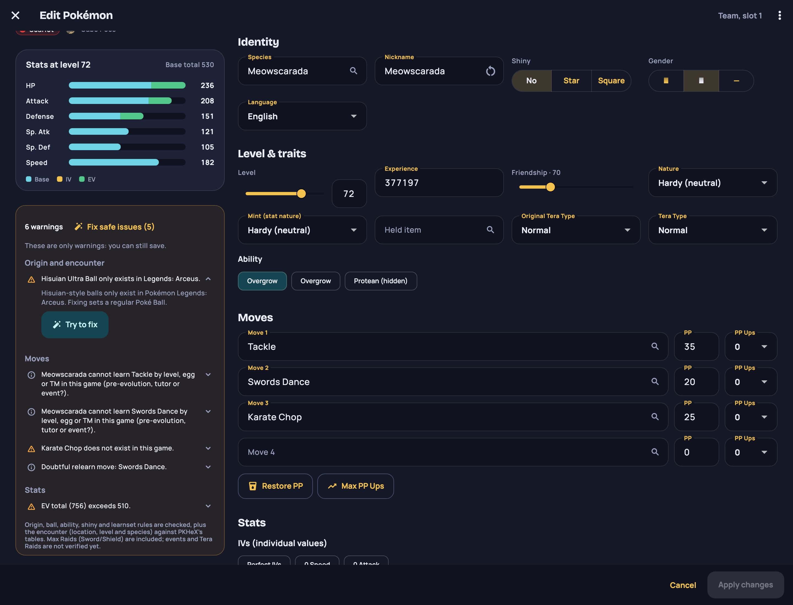
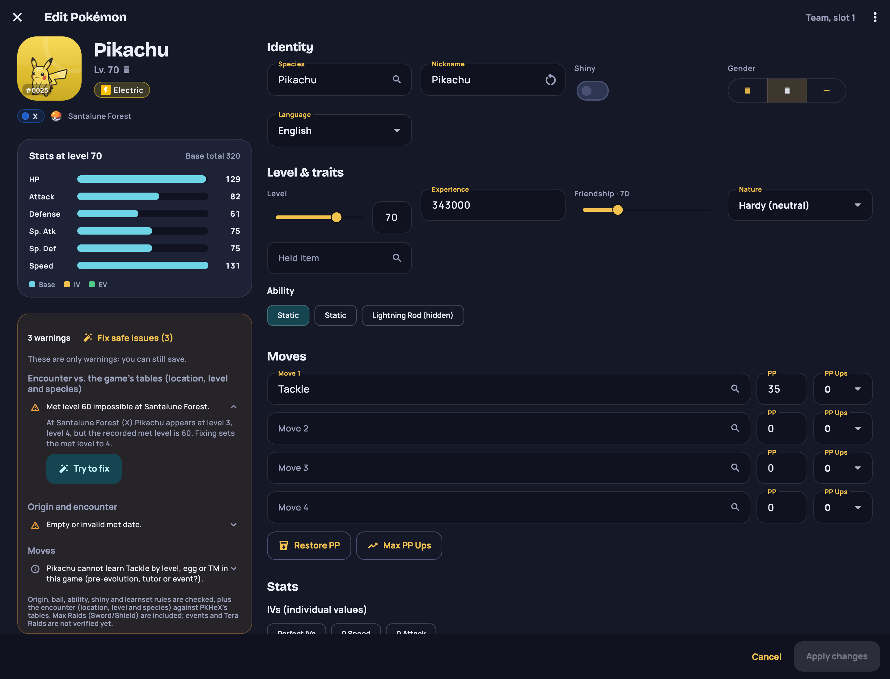

# Legalidad y avisos

El editor comprueba cada Pokémon y muestra **avisos no bloqueantes**,
agrupados por área (origen y encuentro, movimientos, estadísticas, otros
datos) y con una explicación. Son solo avisos: puedes guardar igualmente.

  
  

## Qué se comprueba

* **Movimientos**: que la especie los aprenda o que existan en el juego;
  movimientos recordables.
* **Estadísticas**: IV/EV/AV/GV fuera de rango, nivel y EXP, PP.
* **Otros datos**: objeto, habilidad (incluida la oculta en orígenes Gen 3–4),
  género.
* **Origen**: juego de origen vacío o posterior al formato, Ball que no existía
  en el juego de origen o exclusiva de Leyendas Arceus, Gloria Ball sin marca
  de evento, variocolor bloqueado (legendarios y singulares de cada juego),
  singulares de evento sin «encuentro fatídico», nivel de encuentro.
* **Encuentro**: especie (o preevolución), lugar y nivel contra las tablas de
  encuentros del juego de origen (Gen 3–9), con nombres de lugares.
* **Colosseum y XD**: lugar y nivel contra los Pokémon oscuros, iniciales,
  regalos, intercambios y Poké Spots de cada juego; id oscuro que corresponde
  a la especie; medidor de corazón dentro de rango; **Cinta Nacional** solo y
  siempre en los purificados; marca de encuentro fatídico en todo lo obtenido
  en XD; y que un Pokémon oscuro no salga del juego sin purificar.
* **Cintas y marcas** (al estilo de `RibbonVerifier` de PKHeX): cintas
  imposibles según los juegos por los que pudo pasar, marcas de encuentro fuera
  de su juego o repetidas, huevos con cintas y cintas de evento sin encuentro
  fatídico.

En los juegos cuyas tablas aún no incluyen incursiones, teraincursiones,
brotes, eventos o algunos estáticos, el aviso de encuentro es **informativo**
(ver [Formatos soportados](../formatos.md#limitaciones-conocidas)). En
Gen 1–2 no hay lugar de encuentro que comprobar.

## Intentar corregir

**Intentar corregir** (o **Corregir lo seguro (n)**) aplica solo arreglos
seguros, siempre dentro del borrador: Ball, habilidad, variocolor, movimientos
recordables o por nivel, EVs/IVs/PP, nivel y nivel de encuentro. El nivel de
encuentro solo se ajusta si hay un valor válido que no supera el nivel actual.
**El lugar de captura nunca se cambia solo.** Lo que no tiene corrección
automática se marca como «revísalo a mano». Revisa siempre el resultado antes
de guardar.

## Límites

La legalidad de PKArkTools es una **ayuda**, no un veredicto: está portada
de PKHeX.Core y se valida contra él con saves reales (ver
[Desarrollo › Oráculo PKHeX](../desarrollo.md#oráculo-pkhex)), pero no cubre
todo lo que comprueba PKHeX. Un Pokémon sin avisos no es necesariamente
legal en todos los sentidos, ni uno con avisos informativos es ilegal.

Siguiente: [Saves dañados y reparar checksums](reparar-checksums.md).
