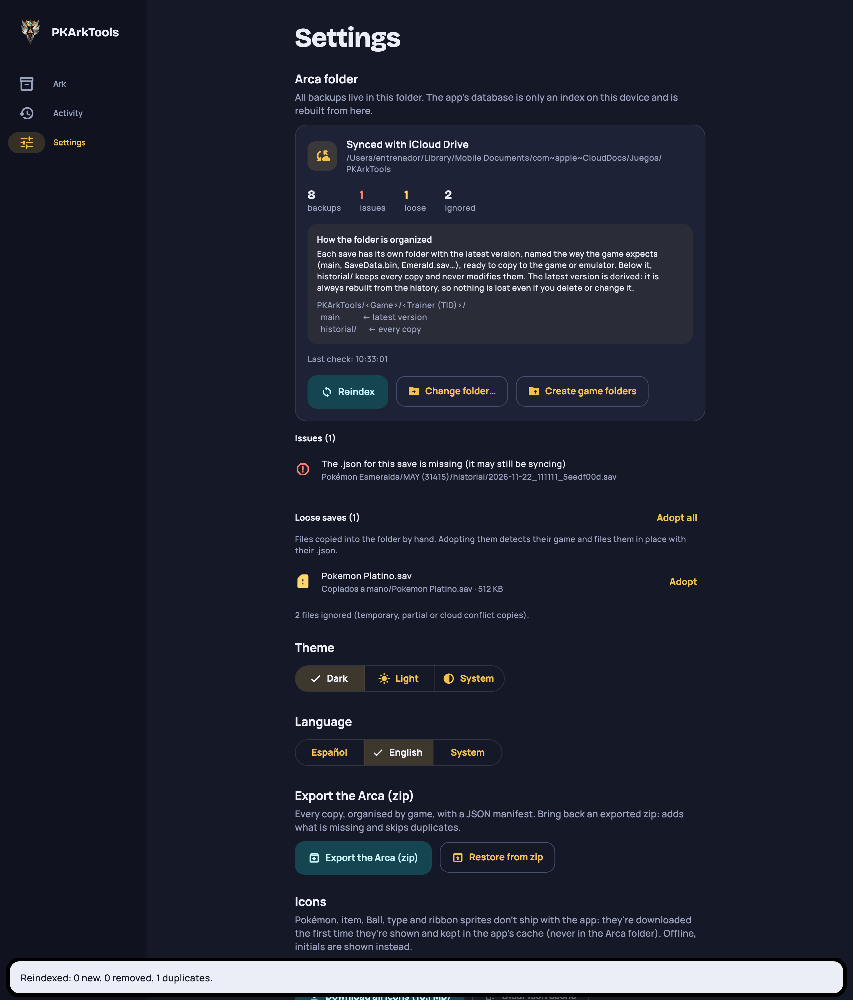
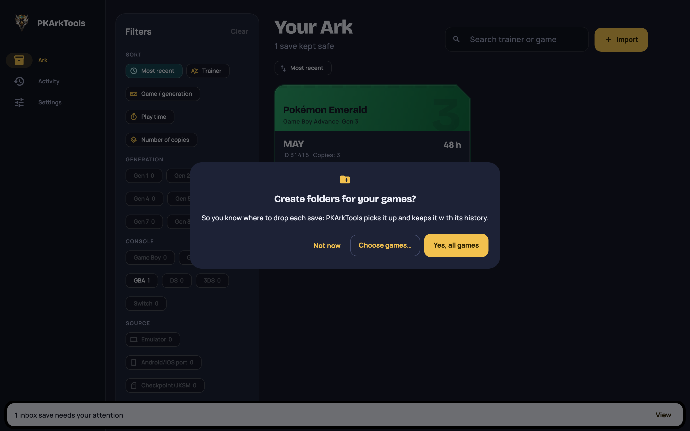
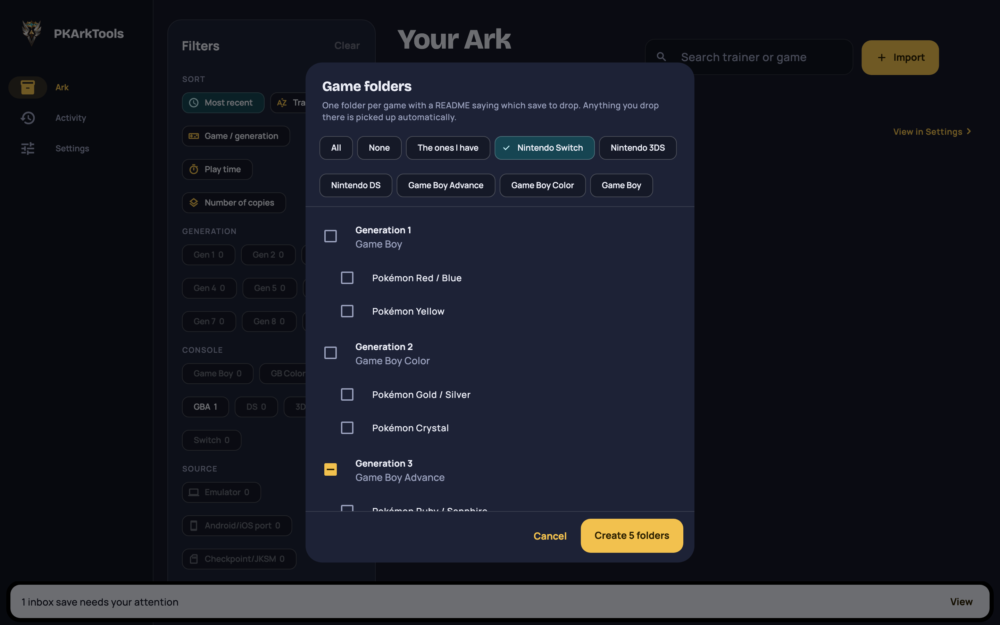
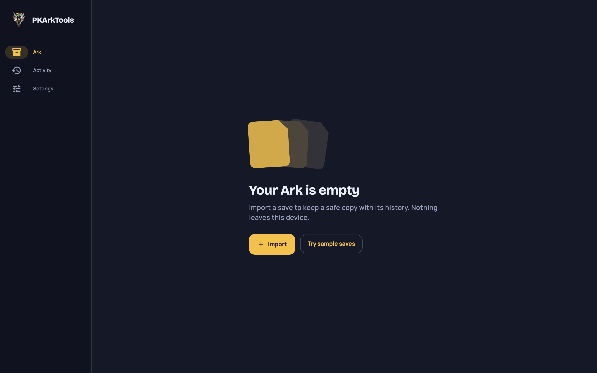
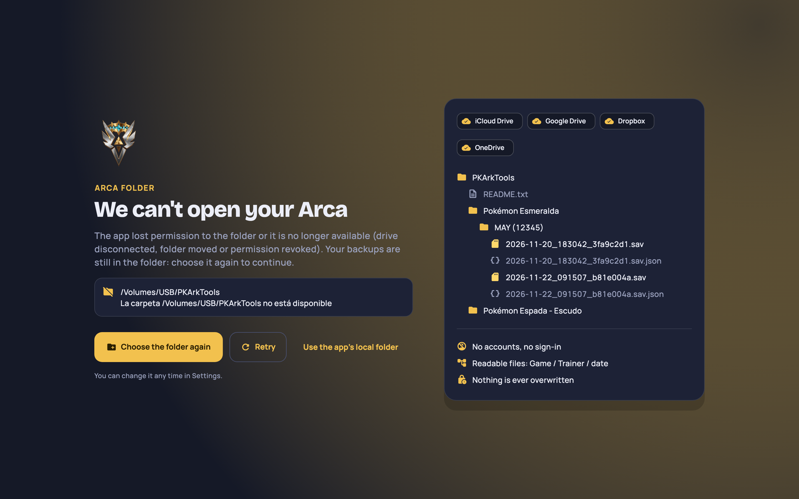

# Primeros pasos

## 1. Elige la carpeta del Arca

En el primer arranque la app te pide **una carpeta**. Todas tus copias vivirán
ahí como archivos normales, legibles sin la app:

```
<carpeta elegida>/PKArkTools/
  README.txt                                   explica la estructura
  Pokémon Esmeralda/                           carpeta del juego (y bandeja de entrada)
    LEEME.txt                                  qué save dejar aquí (opcional)
    MAY (12345)/
      Pokémon Esmeralda.sav                    LA ÚLTIMA VERSIÓN, lista para el juego
      ultima.json                              qué copia del historial es la última
      historial/
        2026-11-20_183042_3fa9c2d1.sav         cada copia, byte a byte (inmutable)
        2026-11-20_183042_3fa9c2d1.sav.json    SHA-256, juego, entrenador, TID/SID,
                                               horas, origen, notas, dispositivo
```

En cada carpeta de entrenador, **el archivo de arriba es siempre la última
versión** con el nombre que espera el juego (`main` en Switch y 3DS,
`SaveData.bin` en Diamante Brillante / Perla Reluciente, `savedata.bin` en
Let's Go, `<Juego>.sav` / `.dsv` / `.srm`… en GB, GBA y DS): cópialo tal cual
al juego o al emulador. Todo lo anterior queda en `historial/`. Más detalles en
[El Arca › La carpeta por dentro](arca.md#la-carpeta-por-dentro).

<p>
  
</p>

* **Elegir carpeta** abre el selector del sistema. En Android es el selector
  de carpetas del sistema (Storage Access Framework): navega hasta la carpeta,
  pulsa «Usar esta carpeta» y luego «Permitir». La app conserva el permiso
  aunque reinicies el teléfono.
* **Usar carpeta local de la app** guarda el Arca dentro de la app. En iOS esa
  carpeta se ve en la app Archivos («En mi iPhone › PKArkTools»).
* Puedes cambiarla cuando quieras en **Ajustes › Carpeta del Arca › Cambiar
  carpeta…**: la app **mueve** o **copia** todas las copias con una barra de
  progreso y comprueba cada una por SHA-256 en el destino. Al mover, solo se
  retiran del origen las copias ya verificadas.

<p>
  
  
</p>

## 2. Carpetas de tus juegos (opcional)

Justo después de elegir la carpeta, la app pregunta **«¿Quieres crear las
carpetas de tus juegos?»**, para que sepas dónde dejar cada save:

* **Sí, todos los juegos** crea `PKArkTools/<Juego>/` para todos los juegos
  soportados, cada una con un `LEEME.txt` corto que dice qué archivo dejar y
  con qué nombre suele venir (Switch: `main` de JKSM/Checkpoint o del
  emulador; 3DS: `main` de Checkpoint; DS: `.sav`/`.dsv`; GBA: `.sav`).
* **Elegir juegos…** abre un selector con casillas: todos, ninguno, los que ya
  tienes en el Arca, por plataforma o por generación.
* **Ahora no** no crea nada y no vuelve a preguntar. Puedes hacerlo cuando
  quieras en **Ajustes › Carpeta del Arca › Crear carpetas de juegos**.

<p>
  
  
</p>

Las carpetas de juego son también una **bandeja de entrada**: deja un save
suelto en `PKArkTools/<Juego>/` (sin renombrarlo) y al abrir la app se recoge
solo. Ver [El Arca › Bandeja de entrada](arca.md#bandeja-de-entrada).

## 3. Varios dispositivos

No hay cuentas ni inicio de sesión. Si la carpeta del Arca está en un servicio
que sincroniza (iCloud Drive, Google Drive, OneDrive, Dropbox, Syncthing…),
todos tus dispositivos comparten el mismo Arca:

* Cada copia del historial es un archivo con nombre único (fecha + hash) que
  **nunca se sobrescribe**, así que dos dispositivos no pueden pisarse. El
  archivo de la última versión se recalcula desde el historial: si dos
  dispositivos lo escriben a la vez, gana la copia más nueva y las «copias en
  conflicto» que deje la nube (`main (1)`…) se retiran solas si su contenido ya
  está en el historial.
* Al abrir la app y al volver a primer plano se revisa la carpeta
  (reindexado incremental). En escritorio, además, se vigilan los cambios.
  También puedes pulsar **Ajustes › Reindexar**.
* Si dos dispositivos importaron el mismo save, se muestra una sola vez.
* Los marcadores de archivos aún no descargados (`.icloud`), los temporales y
  las «copias en conflicto» de los servicios de nube se ignoran sin fallar.

Sugerencias por plataforma: Android → Google Drive o Documentos; iOS/macOS →
iCloud Drive; Windows → OneDrive; Linux → Syncthing.

### En un NAS (carpeta de red)

También puedes poner el Arca en una carpeta compartida de un NAS (Synology,
QNAP, TrueNAS, un Windows o un Mac que comparta una carpeta…) y usarla desde
el Mac y desde Android a la vez:

1. **Mac:** conéctate al recurso (Finder › Ir › Conectarse al servidor,
   `smb://nas.local/Compartido`) y marca «Recordar esta contraseña en el
   llavero». En la app pulsa **Elegir carpeta** y elige una carpeta dentro de
   `/Volumes/Compartido`. Si esa carpeta ya tiene una `PKArkTools/` (la creó
   otro dispositivo), se usa esa: no se crea otra.
2. **Android:** instala un proveedor de documentos SMB (por ejemplo «CIFS
   Documents Provider», libre) y añade el NAS. Después, en **Elegir carpeta**,
   el selector del sistema muestra el NAS: elige la misma carpeta.
3. En **Ajustes › Carpeta del Arca** verás «Carpeta de red (NAS) ·
   NAS/Compartido» con un icono de red.

Cómo se comporta en red:

* **Cambios de otros dispositivos.** macOS no avisa de lo que otros equipos
  escriben en un recurso SMB, así que la app revisa la carpeta **cada minuto
  mientras está en primer plano** y al volver a ella (solo lista la carpeta y
  lee las copias nuevas). Siempre puedes pulsar **Reindexar**.
* **Si el NAS no está montado** al abrir la app (fuera de casa, NAS apagado,
  Wi-Fi caída), aparece **«Carpeta de red no disponible»** con **Reintentar**
  y **Elegir otra**. La app no la trata como un Arca vacía ni crea nada: en
  macOS un recurso desmontado puede dejar `/Volumes/Compartido` como carpeta
  local, y la app comprueba siempre que el NAS sigue montado antes de escribir.
  Al volver a la app con el NAS ya montado se reintenta sola.
* **Red lenta o cortes breves.** Las escrituras son atómicas (temporal +
  renombrar), los errores pasajeros se reintentan con espera creciente y
  ninguna operación se queda colgada: si el NAS no responde, se pasa a «no
  disponible».
* **Archivos del sistema del NAS** (`._*` de macOS, `.DS_Store`, `@eaDir` y
  `#recycle` de Synology, `@Recycle` de QNAP, `.snapshot`, `$RECYCLE.BIN`,
  `Thumbs.db`) se ignoran y ni siquiera se recorren.
* **Nombres.** Los nombres de carpeta se sanean para SMB/Windows (sin
  `: * ? " < > |`, rutas cortas) y la app no distingue mayúsculas ni la forma
  de los acentos (macOS devuelve «Pokémon» descompuesto en los recursos SMB).

Recomendaciones: usa SMB 3 (el predeterminado en macOS y en los NAS actuales);
en Synology, si aparecen archivos `._*`, activa «Compatibilidad con Mac» /
«Flujos de datos alternativos» en SMB; y guarda una copia aparte del NAS
(snapshots del NAS o **Ajustes › Exportar el Arca** a zip). Las mismas reglas
de varios dispositivos de arriba valen para el NAS: el historial nunca se
sobrescribe y la última versión se recalcula desde él.

## 4. Prueba con partidas de ejemplo

Con el Arca vacía (o desde Ajustes) pulsa **Probar con partidas de ejemplo**:
se crean saves sintéticos válidos de varias generaciones, sin datos reales ni
contenido con copyright. Es la forma más rápida de ver el editor.



## 5. Si se pierde el acceso a la carpeta

Si el sistema retira el permiso (bookmark caducado, permiso revocado en Ajustes
del sistema, unidad desconectada), la app muestra una pantalla para
**reintentar** o **elegir otra carpeta**. Tus copias siguen en la carpeta: no
se borra nada.

Si la carpeta está en un NAS que no está montado, la pantalla es **«Carpeta de
red no disponible»** (ver [En un NAS](#en-un-nas-carpeta-de-red)).



## 6. Versiones anteriores

Si usabas una versión con el Arca interna (SQLite + blobs en
`Documentos/PKArkTools/arca`), la app la copia a la carpeta elegida
conservando fechas, orígenes y notas. Solo si todas las copias se verifican,
la carpeta antigua se aparta a `.arca-anterior` (no se borra).

Si tu carpeta del Arca es de PKArkTools 0.1.0 (copias sueltas
`fecha_hash.sav` en la carpeta del entrenador), al abrirla la app las **mueve
solas a `historial/`** y genera el archivo de la última versión. Cada copia se
verifica por SHA-256 antes de retirar la original; si se corta a mitad, la
siguiente vez termina el trabajo sin duplicar ni perder nada.

Siguiente: [Importar saves](importar.md).
