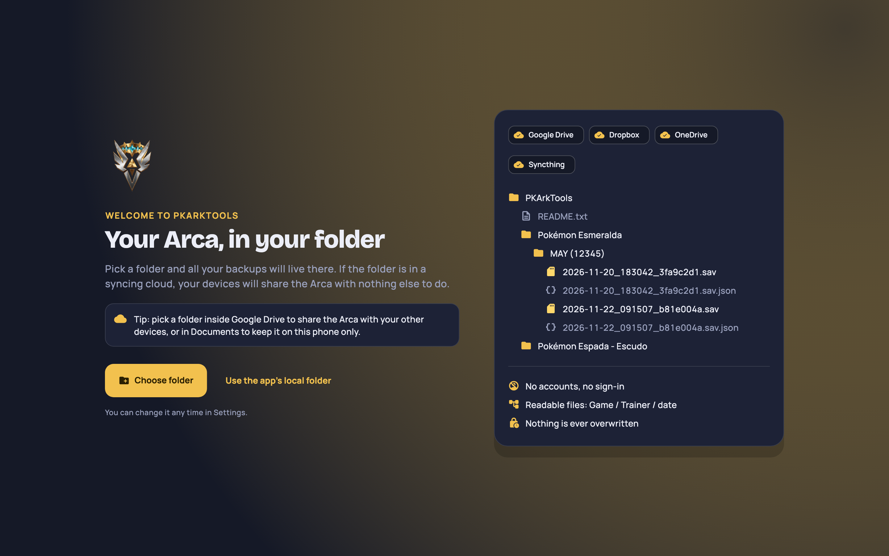
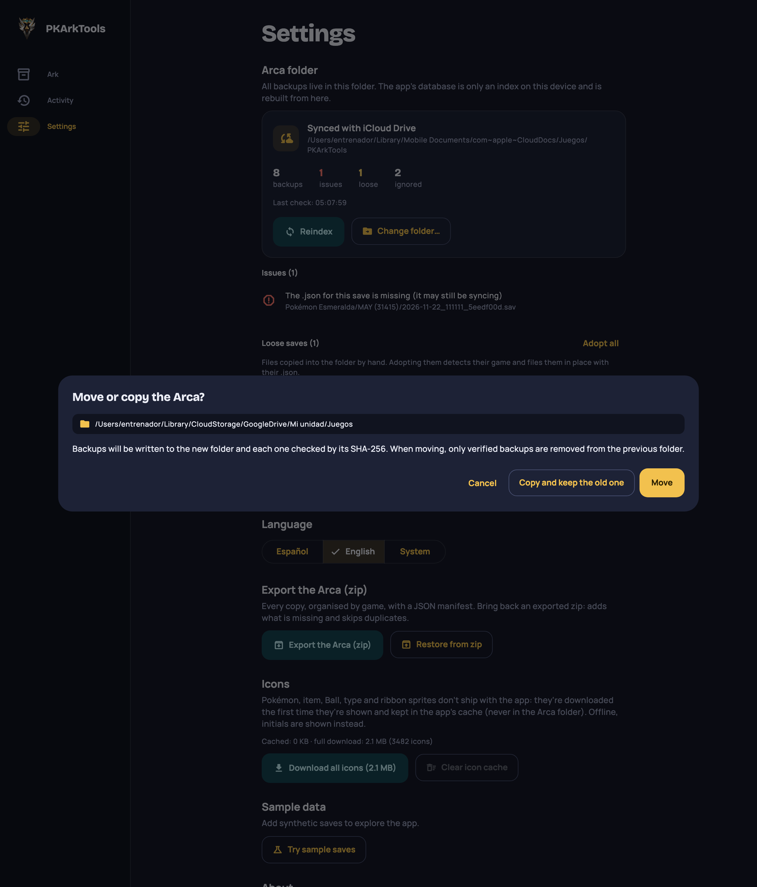

# Primeros pasos

## 1. Elige la carpeta del Arca

En el primer arranque la app te pide **una carpeta**. Todas tus copias vivirán
ahí como archivos normales, legibles sin la app:

```
<carpeta elegida>/PKArkTools/
  README.txt                                   explica la estructura
  Pokémon Esmeralda/MAY (12345)/
    2026-11-20_183042_3fa9c2d1.sav             la copia, byte a byte
    2026-11-20_183042_3fa9c2d1.sav.json        SHA-256, juego, entrenador, TID/SID,
                                               horas, origen, notas, dispositivo
```

<p>
  
</p>

* **Elegir carpeta** abre el selector del sistema. En Android es el selector
  de carpetas del sistema (Storage Access Framework): navega hasta la carpeta,
  pulsa «Usar esta carpeta» y luego «Permitir». La app conserva el permiso
  aunque reinicies el teléfono.
* **Usar carpeta local de la app** guarda el Arca dentro de la app. En iOS esa
  carpeta se ve en la app Archivos («En mi iPhone › PKArkTools»).
* Puedes cambiarla cuando quieras en **Ajustes › Carpeta del Arca › Cambiar
  carpeta…**: la app **mueve** o **copia** todas las copias con una barra de
  progreso y comprueba cada una por SHA-256 en el destino. Al mover, solo se
  retiran del origen las copias ya verificadas.

<p>
  
  
</p>

## 2. Varios dispositivos

No hay cuentas ni inicio de sesión. Si la carpeta del Arca está en un servicio
que sincroniza (iCloud Drive, Google Drive, OneDrive, Dropbox, Syncthing…),
todos tus dispositivos comparten el mismo Arca:

* Cada copia es un archivo con nombre único (fecha + hash) que **nunca se
  sobrescribe**, así que dos dispositivos no pueden pisarse.
* Al abrir la app y al volver a primer plano se revisa la carpeta
  (reindexado incremental). En escritorio, además, se vigilan los cambios.
  También puedes pulsar **Ajustes › Reindexar**.
* Si dos dispositivos importaron el mismo save, se muestra una sola vez.
* Los marcadores de archivos aún no descargados (`.icloud`), los temporales y
  las «copias en conflicto» de los servicios de nube se ignoran sin fallar.

Sugerencias por plataforma: Android → Google Drive o Documentos; iOS/macOS →
iCloud Drive; Windows → OneDrive; Linux → Syncthing.

## 3. Prueba con partidas de ejemplo

Con el Arca vacía (o desde Ajustes) pulsa **Probar con partidas de ejemplo**:
se crean saves sintéticos válidos de varias generaciones, sin datos reales ni
contenido con copyright. Es la forma más rápida de ver el editor.


## 4. Si se pierde el acceso a la carpeta

Si el sistema retira el permiso (bookmark caducado, permiso revocado en Ajustes
del sistema, unidad desconectada), la app muestra una pantalla para
**reintentar** o **elegir otra carpeta**. Tus copias siguen en la carpeta: no
se borra nada.


## 5. Versiones anteriores

Si usabas una versión con el Arca interna (SQLite + blobs en
`Documentos/PKArkTools/arca`), la app la copia a la carpeta elegida
conservando fechas, orígenes y notas. Solo si todas las copias se verifican,
la carpeta antigua se aparta a `.arca-anterior` (no se borra).

Siguiente: [Importar saves](importar.md).
