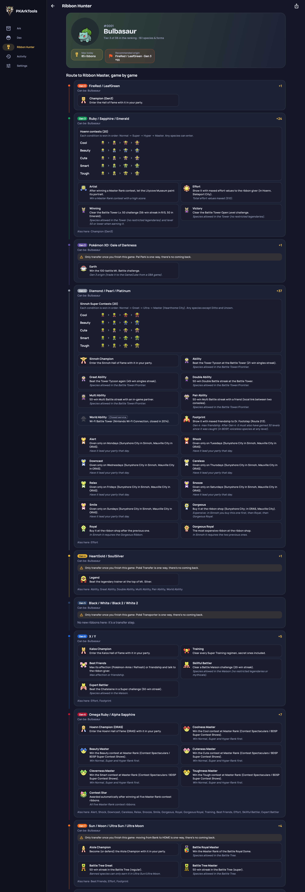
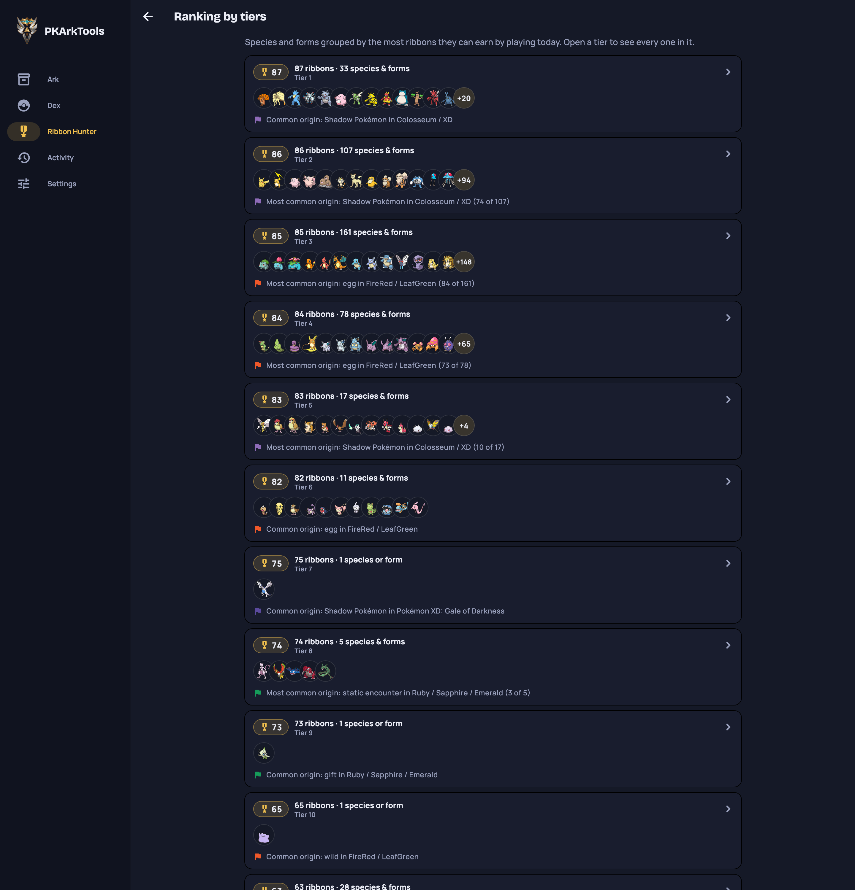
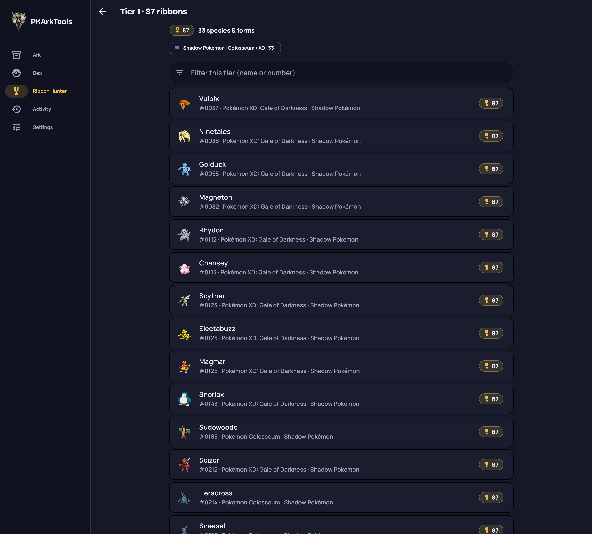
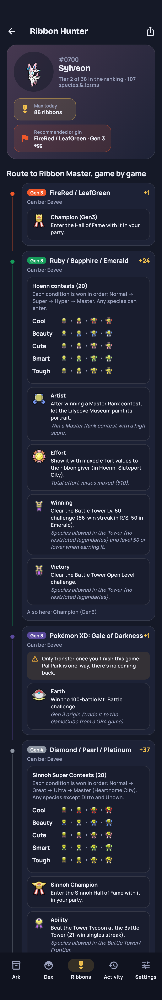
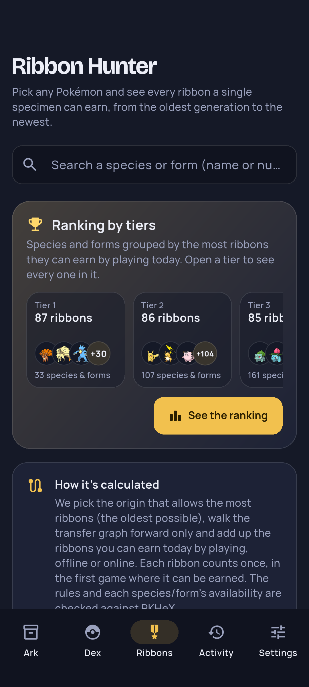
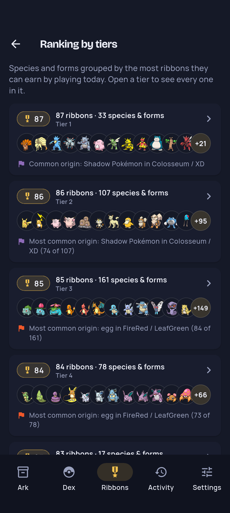
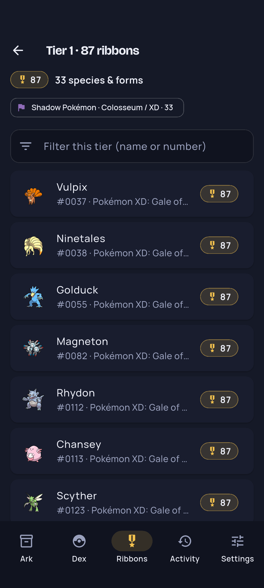
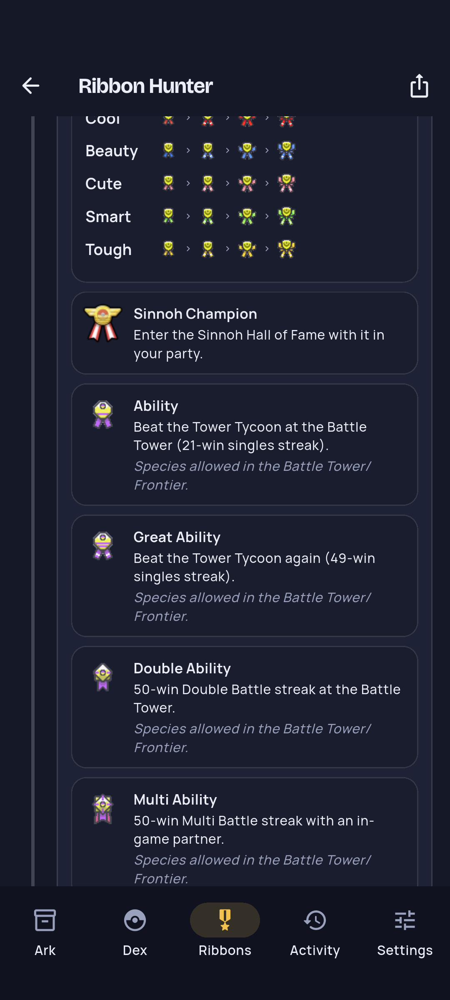
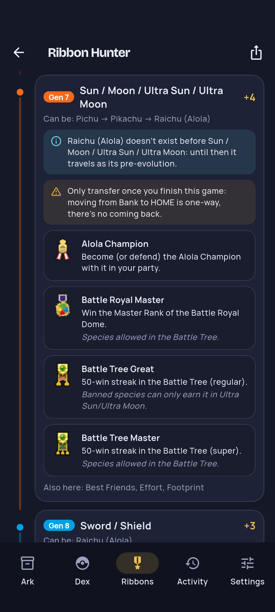
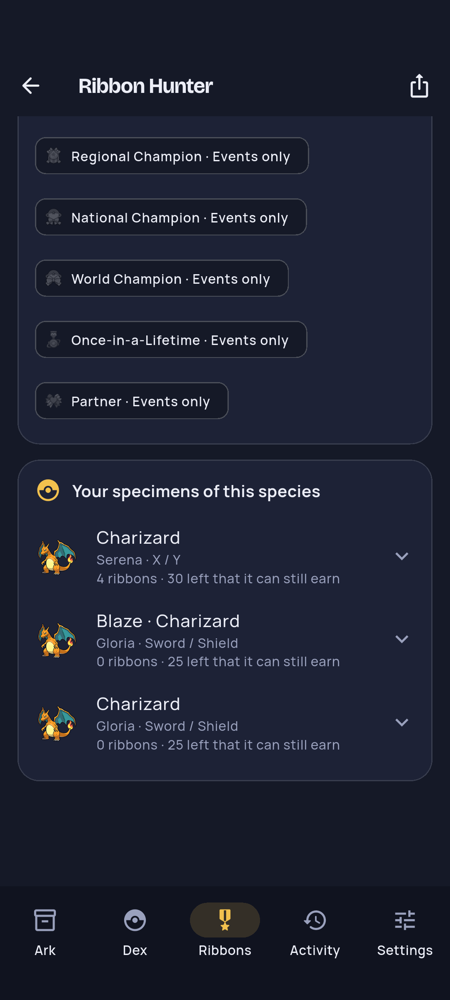

# Ribbon Hunter

La pestaña **Ribbon Hunter** es una guía **por especie**, no por ejemplar:
eliges cualquier Pokémon (especie y forma) y la app te explica **todas las
cintas que puede ganar un mismo ejemplar**, juego a juego, de la generación
más antigua a la más nueva. También tiene un **ranking por niveles** que
agrupa las especies y formas según el máximo de cintas que pueden ganar.
El objetivo de cada guía es llevar a un ejemplar a **Ribbon Master**: que
consiga todas las cintas que hoy se pueden ganar jugando.

<p align="center">
  
</p>

## Cómo se usa

* **Buscador**: escribe un nombre (en español o en inglés) o un número de la
  Pokédex. Salen todas sus formas con guía: Raichu y Raichu de Alola,
  Typhlosion y Typhlosion de Hisui, etc.
* **Ranking por niveles**: como muchas especies empatan (33 pueden ganar 87
  cintas, 107 pueden ganar 86…), el ranking no es una lista de especies sino
  de **niveles**, uno por cada máximo de cintas, del más alto al más bajo:
  «87 cintas · 33 especies y formas», «86 cintas · 107 especies y formas»…
  Están **todos** los niveles. Cada nivel muestra una fila de iconos de
  muestra y su **origen común** destacado (p. ej. «Origen común: Pokémon
  oscuro en Colosseum / XD», o «Origen más común: huevo en Rojo Fuego / Verde
  Hoja (84 de 161)» si no lo comparten todas).
* **Al entrar en un nivel** se ve la lista completa de sus especies y formas,
  ordenada por número de Pokédex, con un filtro por nombre o número y el
  reparto de orígenes del nivel. Al tocar una se abre su guía; «atrás» vuelve
  al nivel. En el inicio de la pestaña, las tarjetas de los primeros niveles
  llevan directamente a cada uno.
* **Desde la Dex**: la ficha de cada especie tiene el botón **Guía Ribbon
  Hunter** con la forma que estés viendo.

<p>
  
  
  
</p>

En Android (emulador):

<p>
  
  
  
  
  
  
</p>

## La guía de una especie

* **Cabecera**: icono, **máximo de cintas hoy**, su nivel en el ranking (al
  tocarlo se abre ese nivel) y el
  **origen recomendado** (juego, generación y tipo de encuentro: huevo,
  salvaje, Pokémon oscuro, regalo, GO…).
* **Ruta para convertirlo en Ribbon Master, juego a juego**: una tarjeta
  por juego en orden cronológico. Cada una dice cómo puede estar el Pokémon
  en ese juego («Puede estar como: Pichu → Pikachu») y lista las cintas **nuevas** que se ganan ahí, con cómo
  conseguirlas en una línea y su requisito. Cada cinta se cuenta **una vez**,
  en el primer juego de la ruta donde se puede ganar; si otro juego también
  la da, aparece en «También aquí». Las 20 cintas de concurso de Hoenn y las
  20 de Sinnoh se agrupan en una tarjeta con los cuatro rangos de cada
  categoría en orden.
* **Avisos**:
  * «Transfiere solo cuando termines este juego»: el Parque Compi, el
    Pokétransfer, el Poké Transporter y el paso del Banco a HOME son de ida.
  * «X no existe antes de…»: la forma aparece en ese juego y hasta entonces
    viaja como su preevolución (Raichu de Alola viaja como Pichu/Pikachu
    hasta Sol/Luna; Weezing de Galar como Koffing hasta Espada/Escudo).
  * «Aquí solo puede estar como…»: un juego que solo admite la
    preevolución (Sylveon no está en Diamante Brillante/Perla Reluciente:
    hay que pasar por ahí como Eevee antes de evolucionarlo).
  * «Desde aquí puedes ir y volver con Pokémon HOME».
* **Recuerdos de Gen 3 y 4**: al llegar a Gen 6 las cintas de concurso y de
  combate de Gen 3/4 se convierten en los Recuerdos de Concurso (hasta 40) y
  de Combate (hasta 8). La guía cuenta cada cinta ganada en el camino y
  además dice cuántas verás en el juego final.
* **Marcas**: no suman al total. Se indica qué marcas puede ganar un ejemplar
  ya capturado en Escarlata/Púrpura (Recolección, Compañerismo, Sibaritismo)
  y, si la especie se puede capturar en Espada/Escudo o Escarlata/Púrpura,
  que allí puede llevar **una** marca de encuentro.
* **No disponibles hoy**: cintas de eventos y repartos (Clásica, Premier,
  Deseo, País, Mundial, Recuerdo…) y las que dependían de un servicio en línea
  cerrado (Habilidad Mundial de la Torre Batalla Wi-Fi). No suman.
* **Tus ejemplares de esta especie**: los que hay en tu Arca con esa forma,
  cuántas cintas tienen y, al desplegarlos, **las que les faltan y aún pueden
  ganar** desde el juego donde están (solo juegos a los que todavía pueden
  ir).
* **Compartir**: copia la guía como **texto para foros** o guárdala como
  **imagen** (cabecera y ruta).

## Metodología

### 1. Tabla de cintas

Las cintas y marcas de Gen 3–9 (posiciones y nombres) están portadas de
PKHeX. Para la guía, cada cinta tiene: juego(s) donde se gana, método en una
línea y requisito (textos propios, sin textos oficiales), y una de estas
clases:

| Clase | Cuenta para el máximo | Ejemplos |
|---|---|---|
| Jugando | Sí | Concursos, Campeón de cada región, instalaciones de batalla, Esfuerzo, Mejores amigos, Huella, cintas diarias, Hisui, Estrella Rutilante |
| En línea (servicio activo) | Sí | Rango Master del Combate Clasificatorio (Espada/Escudo, Escarlata/Púrpura) |
| Servicio en línea cerrado | No | Habilidad Mundial (Torre Batalla Wi-Fi, cerrada en 2014) |
| Solo eventos | No | Clásica, Premier, Deseo, País, Mundial, Recuerdo, Cumpleaños, Campeón de torneos… |

La **Cinta Nacional** (purificar un Pokémon oscuro) y la **Cinta Tierra**
(100 combates del Monte Batalla) se ganan **jugando** a Pokémon Colosseum y XD
(GameCube), así que cuentan; la Nacional solo para especies que tienen un
Pokémon oscuro en su línea evolutiva.

### 2. Grafo de transferencias

Solo hacia adelante:

```text
Colosseum / XD ⇄ RZE / RFVH ─Parque Compi→ DPPt ⇄ HGSS ─Pokétransfer→ NB/N2B2
  ─Poké Transporter→ XY ⇄ ROZA ⇄ SL/USUL ─Banco→HOME→ EsEs ⇄ DBPR ⇄ LPA ⇄ EsPu ⇄ LPZA
Consola Virtual (Gen 1/2) ─Poké Transporter→ SL/USUL
Let's Go / Pokémon GO ─(solo de ida)→ HOME
```

Los ids de juego son estables (`colosseum`, `xd`, `rse`, `frlg`, `dppt`,
`hgss`, `bw`, `xy`, `oras`, `smusum`, `vc`, `lgpe`, `go`, `swsh`, `bdsp`,
`pla`, `sv`, `za`).

### 3. Disponibilidad por especie y forma

Con el oráculo PKHeX (`tools/pkhex_oracle`, comando `ribbons`), para cada
especie y forma (1333 con origen jugable o de evento):

1. Se piden a PKHeX todos los encuentros que pueden acabar en esa forma,
   también como preevolución (huevos, salvajes, fijos, Pokémon oscuros,
   regalos, intercambios, GO, eventos).
2. Cada candidato se convierte al formato más reciente donde existe la forma
   (Parque Compi, Pokétransfer, Banco, HOME), se evoluciona, se sube a nivel
   100 con afecto y amistad máximos y PKHeX le aplica **todas las cintas
   válidas** (`RibbonApplicator.SetAllValidRibbons`, que usa `RibbonVerifier`).
   Para orígenes de Gen 3–5 se repite en formato PK5, que es el único que
   guarda las cintas de concurso y combate de Gen 3/4.
3. Gana el candidato con **más cintas jugables**; a igualdad, el que no es de
   evento, el que no es de GO y el más antiguo.

De ahí sale, versionada en
`packages/pkcore/lib/src/data/generated/ribbon_master_data.dart`: el origen y
la cadena de evoluciones que puede tener en cada juego (PKHeX
`EvolutionHistory`), que dice qué juegos puede visitar y como qué especie.
**No incluye las cintas**: las calcula el motor de pkcore.

### 4. Ruta máxima

`RibbonMaster.route` (pkcore) recorre los juegos visitables en orden y aplica
las reglas de cada cinta (portadas de PKHeX `RibbonRules`): especies vetadas
en el Frente Batalla, Torre Batalla, Maison y Árbol Batalla; Ditto y Unown
fuera de los Superconcursos; Huella con 30 niveles ganados fuera de Gen 4
(o especies sin voz en DBPR); Estrella Rutilante solo con la Estelar de
Concursos; singulares fuera de la Torre de DBPR; Victoria/Ganador según el
nivel; Rango Master según la fecha de los singulares de GO, etc.

### 5. Verificación contra PKHeX

`packages/pkcore/test/ribbon_master_pkhex_test.dart` compara, para las 1333
especies y formas, las cintas que la ruta da por legales con las que PKHeX
acepta para el mismo origen (`test/data/ribbon_oracle.csv.gz`, versionada):
**0 contradicciones** en las dos direcciones (ninguna cinta de más, ninguna de
menos), y los recuerdos de concurso y combate coinciden. Única excepción
documentada: Pikachu gorra (forma 9), un regalo que trae de serie la cinta de
Campeón de Alola.

Para regenerar los datos (necesita .NET 10 y PKHeX en `.ref/PKHeX`):

```bash
tool/gen_ribbon_master_data.sh
```

### Resultado

38 niveles, de 87 a 0 cintas. Los primeros:

| Nivel | Cintas | Especies y formas | Origen más común |
|---|---|---|---|
| 1 | 87 | 33 | Pokémon oscuro en Colosseum / XD (todas) |
| 2 | 86 | 107 | Pokémon oscuro en Colosseum / XD (74) |
| 3 | 85 | 161 | huevo en Rojo Fuego / Verde Hoja (84) |
| 4 | 84 | 78 | huevo en Rojo Fuego / Verde Hoja (73) |
| 5 | 83 | 17 | Pokémon oscuro en Colosseum / XD (10) |
| 6 | 82 | 11 | huevo en Rojo Fuego / Verde Hoja (todas) |

Las 33 del nivel 1 (Vulpix, Ninetales, Golduck, Magneton, Rhydon, Chansey,
Scyther, Electabuzz, Magmar, Snorlax…) tienen un Pokémon oscuro de Colosseum o
XD en su línea evolutiva, que añade la Cinta Nacional al recorrido completo de
Gen 3 a Gen 9.

## Fuentes

* [PKHeX](https://github.com/kwsch/PKHeX) (GPL-3.0): estructura de las cintas,
  reglas de legalidad (`RibbonRules`, `RibbonVerifier*`), encuentros,
  evoluciones por juego y conversión entre formatos. Los nombres de las cintas
  son © Nintendo/Game Freak/Creatures.
* Lugares concretos (Ciudad Marina, Ciudad Malvalona, Ruta 213…) y rachas de
  las instalaciones: datos de juego contrastados con guías públicas; los
  textos de la guía son propios.
